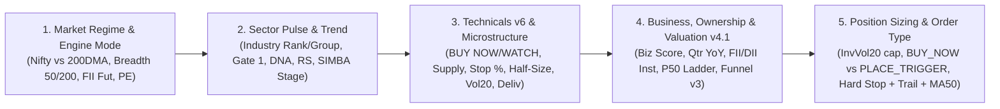

# Blind Point-in-Time Time-March: UltraTech Cement (`ULTRACEMCO.NS`) & Kalyan Jewellers (`KALYANKJIL.NS`)

**Window:** `2026-02-27` → `2026-11-25` (182 NSE trading sessions, 8 pre-committed checkpoints)  
**Starting Capital:** ₹10,00,000 (100% cash) · **Execution Friction:** 20 bps/side (40 bps round-trip) · **Max Single-Stock Cap:** 50% NAV  
**Anti-Lookahead Protocol:** A dedicated **Blind Lead Quant Trader** subagent (zero filesystem/search access) received strictly point-in-time (`<= t`) dashboard packets one gate at a time (`gate_01` → `gate_08`). Between gates, orders, triggers, hard stops, MA50 exits, and trailing stops were executed mechanically day-by-day on sealed OHLCV bars via [sim_step.py](./sim_step.py). Only after final attribution was sealed were **3 specialist critic subagents** invoked to audit every call and inspect the dashboard's source modules.

---

## 1. Executive Scorecard & The Structural Paradox

| Strategy / Benchmark (`2026-02-27` → `2026-11-25`) | Total Return | Max Drawdown | Sharpe | Activity / Range |
|---|---:|---:|---:|---|
| **Blind Quant Trader (Dashboard PIT)** | **−4.59%** | **−5.02%** | **−2.097** | 4 round-trips (8 fills), 0% win rate (`−₹45,902`; final NAV `₹9,54,098`) |
| `MECH_G1_BUYNOW_ULTRACEMCO` *(Dashboard Mechanical)* | **0.00%** | **0.00%** | 0.000 | **0 trades** (`39` Gate-1 days, **`0` `BUY NOW` days** in 182 sessions) |
| `MECH_G1_BUYNOW_KALYANKJIL` *(Dashboard Mechanical)* | **+0.16%** | **−10.26%** | 0.111 | **3 trades** (`58` Gate-1 / `46` `BUY NOW` days; first fired `Jul 20 @ ₹570`) |
| `BH_ULTRACEMCO` *(Buy & Hold)* | +0.97% | −18.26% | 0.184 | `₹12,677` → `₹12,800` (Low `₹10,362` Mar 23; High `₹12,939` Nov 20) |
| `BH_KALYANKJIL` *(Buy & Hold)* | **+55.17%** | −26.35% | **1.427** | `₹410.10` → `₹636.35` (Low `₹330.80` Jun 11; High `₹710.90` Nov 12) |
| `BH_50_50` *(Equal-Weight Passive)* | +28.07% | −17.34% | 1.162 | Passive 50/50 blend across both stocks |
| `NIFTY_50` *(Market Baseline)* | +2.54% | −11.70% | 0.300 | `25,178.65` → `25,819.25` (Trough `22,331.4` on Mar 30, `−15.18%` off 52W H) |

> [!IMPORTANT]
> **The Million-Dollar Finding:** This blind test exposed a profound **structural paradox** in our dashboard — NOT just in human discretion. **Both** the expert blind quant trader (`−4.59%`, `−5.02%` DD) **and** our dashboard's own mechanical `Gate 1 + BUY NOW` rule (`0.00%` on UltraTech, `+0.16%` on Kalyan) delivered elite capital preservation during an 8-month choppy bear market, yet captured **zero net alpha** on a `+55.17%` secular grower (`KALYANKJIL`) and sat out `+16–20%` valuation-ladder rebounds on `ULTRACEMCO`. The 3 critics traced this directly to **specific code-level blind spots in `forensics.py` and `valuation.py`**, a flat `45-day` shareholding lag, a permanently `null` India VIX feed, and running a single pure-breakout playbook on two completely different stock archetypes.

### Realized Trade Ledger (`₹10,00,000` → `₹9,54,098.26`)

| # | Ticker | Entry Date & Px | Entry Trigger | Exit Date & Px | Exit Reason | Shares | Trade Return | Net P&L (₹) |
|---:|---|---|---|---|---|---:|---:|---:|
| 1 | `KALYANKJIL.NS` | `2026-04-07` @ `₹435.00` | `TRIGGER@415.0` (+4.8% open gap) | `2026-04-24` @ `₹412.80` | `TRAIL_8%_HIT` | 344 | −5.29% | −₹8,220 |
| 2 | `KALYANKJIL.NS` | `2026-05-04` @ `₹414.00` | `BUY_NOW` (15% starter) | `2026-05-11` @ `₹385.00` | `HARD_STOP@385.0` | 359 | −7.19% | −₹10,985 |
| 3 | `ULTRACEMCO.NS` | `2026-07-22` @ `₹12,081.00` | `TRIGGER@12050.0` (200-DMA break) | `2026-08-19` @ `₹11,499.00` | `MA50_BREAK` (`11499 < 11637.5`) | 20 | −5.01% | −₹12,583 |
| 4 | `KALYANKJIL.NS` | `2026-09-16` @ `₹606.90` | `BUY_NOW` (20% tight squeeze) | `2026-09-28` @ `₹565.00` | `HARD_STOP@565.0` | 319 | −7.09% | −₹14,114 |
| **Total** | **2 stocks** | **4 entries** | **2 triggers · 2 BUY_NOW** | **4 exits** | **2 Hard Stops · 1 Trail · 1 MA50** | — | **−4.59% NAV** | **−₹45,902** |

*Per-stock realized P&L:* `ULTRACEMCO.NS` = `−₹12,583` (`1` trade); `KALYANKJIL.NS` = `−₹33,319` (`3` trades). Source: [final_attribution.json](./final_attribution.json).

---

## 2. Dashboard Decision Hierarchy Used by the Quant Trader

- **Top-Down Risk Governor:** `engine_mode` (`BEAR` = 8% trail / cash default; `CAUTION` = 12% trail / selective `15–25%` probes; `BULL` = 15% trail / full risk-on), `breadth_above_50dma_pct` / `200dma_pct`, `nifty_pe`, and `fii_idx_futures_long_pct`.
- **Trend & Sector Filter:** `industry_board` rank/group (`LEADING` vs `LAGGING/DOWNTREND`), `gate1` (`Close > MA50 & MA200 & >= 85% 52W H`), `comp_rs` (`1W/1M/3M`), and `SIMBA` Stage (`1–4`), `MTF (0–3)`, `caution`, and `dist_days`.
- **Entry & Risk Geometry:** `forensics` (`action`, `state`, `supply`, `signature`, `stop_pct`, `half_size`), `vol20_ann_pct` + `invvol20_w_mult`, and `deliv_pct` / `deliv_ratio`.
- **Fundamental & Valuation Context:** PIT `fund_trends` (`verdict`, `score`), PIT quarterly `sales_yoy / opm / np_yoy / inst_label`, `valuation` v4.1 (`rating`, `cmp_pct`, `p50`, `ladder`), and `funnel_v3` score/chips.

---

## 3. Chronological 8-Gate Blind Time-March (`2026-02-27` → `2026-11-25`)

### Gate-by-Gate Overview Matrix

| Gate & Date | Market Regime & Breadth | `ULTRACEMCO.NS` (PIT State → Order) | `KALYANKJIL.NS` (PIT State → Order) | Inter-Gate Outcome → End NAV |
|---|---|---|---|---|
| **G1** `2026-02-27` | `CAUTION` (12%) · Nifty `25,179` (−0.7% 200D) · Breadth `33%/27%` `BEAR` · PE `22.0` | `₹12,677` · Gate1 · Stage 3 · `WATCH` (`BEAR anchor`) · `HOLD P53` → **`PLACE_TRIGGER` 20% @ `₹13,120`** (stop `12,380`) | `₹410.1` · Stage 4 · `DISTRIBUTION` · `caution=3` · `Biz 72` (`NP +90%`) · `UNRATED` → **`AVOID` (0%)** | Nifty crashed `−11.3%`; UltraTech broke 50D (`Mar 4`), trigger unfilled → **`₹10,00,000` (0.00%)** |
| **G2** `2026-03-30` | `BEAR` (8%) · Nifty `22,331` (−11.5% 200D) · Breadth `12.5%/13.7%` · PE `19.6` | `₹10,745` · Stage 4 · `ADX 47.4` · `8 dist_days` · `vol 49%` · `ACCUMULATE P28` → **`WAIT` (0%)** | `₹375.9` · Stage 4 `VETO` · `rs1m +5.0%` · `0 dist_days` · `deliv 1.43×` · `vol 59→40%` → **`PLACE_TRIGGER` 15% @ `₹415`** (stop `380`, `8%` trail) | Kalyan gapped open `₹435` (`Apr 7`, +4.8% slip), hit `8%` trail `₹412.8` (`Apr 24`, `−5.29%`) → **`₹9,91,780` (−0.82%)** |
| **G3** `2026-04-30` | `CAUTION` (12%) · Nifty `23,998` (−4.4% 200D) · Breadth **`78.7%/41.2%`** `CHOPPY` · FII `11.5%` | `₹11,586` · Broke 50D today · Cement **`#54/54`** · `vol 29%` · `ACCUMULATE P35` → **`PLACE_TRIGGER` 20% @ `₹12,200`** (stop `11,500`) | `₹412.75` · Reclaimed 50D · `DNA BUY` · `RS3M +16.6%` · Stage 4 `VETO` · stop `3.4%` → **`BUY_NOW` 15%** (stop `385`, `12%` trail) | Kalyan bought `₹414` (`May 4`), hard-stopped `₹385` (`May 11`, `−7.19%`); UltraTech chopped below trigger → **`₹9,80,795` (−1.92%)** |
| **G4** `2026-06-15` | `CAUTION` (12%) · Nifty `23,854` (−4.3% 200D) · Breadth `64.2%/51.0%` `MILD BULL` | `₹11,466` · **Stage 4→1** · `vol 22%` · Q4 **OPM 22% (+2pp)** · DII `+0.97pp` · `ACCUMULATE P34` → **`PLACE_TRIGGER` 25% @ `₹12,050`** (stop `11,380`) | `₹383.0` · Q4 **Sales +66%, NP +118%** · DII sold `−1.1pp` · **`deliv 15.9% (0.44×)`** · `vol 54%` → **`AVOID` (0%, no trigger)** | UltraTech triggered `₹12,081` (`Jul 22`, 20 sh); **Kalyan exploded +60% to `₹612.6`** (missed!) → **`₹9,76,752` (−2.32%)** |
| **G5** `2026-07-31` | `CAUTION` (12%) · Nifty `24,384` (−1.6% 200D) · Breadth `53.6%/57.7%` `MILD BULL` | `₹11,903` (Held @ `12,105`) · Gate1 · `caution=0` · Low-vol 200D backtest → **`HOLD` 24%** (stop `11,380`, MA50 exit) | `₹612.6` · Stage 2 · `BUY NOW` · `RS +47.6` · **`+41.4%` vs 50D** · `vol 82%` · `23.4%` `half_size` stop → **`PLACE_TRIGGER` 12% @ `₹652`** (stop `560`) | UltraTech broke 50D (`Aug 19 @ ₹11,499`, `−5.01%`, saved −7% slide to `10,697`); Kalyan coiled sideways → **`₹9,68,212` (−3.18%)** |
| **G6** `2026-09-15` | `BEAR` (8%) · Nifty `23,119` (−5.8% 200D) · Breadth `32.7%/51.7%` · PE `19.5` | `₹10,697` · Stage 4 `VETO` · Cement `#52/54` · `RSI 27.7` · Q1 OPM `20% (−1pp)` → **`AVOID` (0%)** | `₹604.2` · Stage 2 · `BUY NOW` · **Tight Squeeze (`BBP 15.9`)** · `vol 33.6%` · `5.9%` stop · `INSIDE shelf` · Jun `DISTRIBUTING` → **`BUY_NOW` 20%** (stop `565`, `9%` trail) | Kalyan bought `₹606.9` (`Sep 16`), hard-stopped `₹565` (`Sep 28`, `−7.09%`, saved −12% drop to `498`) → **`₹9,54,098` (−4.59%)** |
| **G7** `2026-10-30` | `CAUTION` (12%) · Nifty `23,053` (−4.1% 200D) · Breadth **`16.4%/36.0%`** `MILD BEAR` · PE `19.3` | `₹11,045` · Broke 50D today · Cement **`0% >200D`** (`#51/54`) · `7 dist_days` · `NEAR OVERHANG` → **`WAIT` (0%)** | `₹498.0` · −12.9% vs 50D · `CompRS −14.0` · `NDI 29.3 >> PDI 14.9` · `RSI 32.9` → **`AVOID` (0%, no trigger)** | Nifty ripped **`+12.0%`** into `BULL`; UltraTech `+15.9%` (`12,800`), Kalyan `+27.8%` (`636.35`, peak `710.9`) → **`₹9,54,098` (−4.59%)** |
| **G8** `2026-11-25` *(Today)* | **`BULL`** (15%) · Nifty `25,819` (+7.6% 200D) · FII **`34.1%` (98th%ile)** · Breadth `37.8%/43.9%` `CHOPPY` | `₹12,800` · Stage 2 · Cement **`#11/54 LEADING`** · Q2 `ACCUMULATING` (DII `20.9%`) · `12.2%` `half_size` stop → **`BUY_NOW` 22%** (stop `11,600`) | `₹636.35` · **Funnel `64.1` Grade B (0 cons)** · `MTF 3/3` · `BUY NOW` · Q2 **NP +63.6%**, FII `ACCUMULATING` · `DISTRIBUTION` bar → **`BUY_NOW` 18%** (stop `565`) | **Forward Posture (Today):** 40% deployed (22% UltraTech / 18% Kalyan, ~2% risk each), 60% cash buffer |

### Key Turning Points & Missing Signals Logged Live at Each Gate

1. **Gate 1 (`2026-02-27` — Bear Deterioration Begins):** Refusing immediate entry on UltraTech's `Stage 3 / BEAR anchor` (using `PLACE_TRIGGER @ ₹13,120`) and avoiding Stage 4 `DISTRIBUTION` Kalyan preserved 100% cash through March's `−11.3%` Nifty crash.
   - *Missing signals wished for:* `India VIX` (null), FII 5d/20d cash flows, news/pledge/block-deal overhang feed for Kalyan, and 20-day swing pivots / earnings AVWAP.
2. **Gate 2 (`2026-03-30` — Deep Bear Trough):** Rightly skipped UltraTech (`ADX 47.4`, `8 dist_days`, `49% vol`) despite `ACCUMULATE P28`, and spotted early RS divergence in Kalyan (`rs1m +5.0%`, `0 dist_days`, `deliv 1.43×`, `vol 59%→40%`). However, the unguarded `₹415` trigger suffered a `+4.8%` next-open gap (`₹435` on Apr 7) and got clipped by the `8%` bear trail (`₹412.8`, `−5.29%`).
   - *Missing signals wished for:* VIX + 52W New Lows capitulation internals, **up-day vs. down-day delivery split**, and Q4 FY26 operational update / earnings dates.
3. **Gate 3 (`2026-04-30` — 78.7% Breadth Thrust):** Adapted to Gate 2's gap slippage by buying a `15%` starter probe in Kalyan right at its rising 50-DMA (`₹412.75`, `DNA BUY`, `RS3M +16.6%`), while arming a `₹12,200` 200-DMA breakout trigger on UltraTech. Kalyan immediately broke down on May 11 (`HARD_STOP@385.0`, `−7.19%`).
   - *Missing signals wished for:* Actual Q4 earnings dates (flat 45-day lag still showed `Dec 2025`), FII vs. DII daily cash flows, and Volume-at-Price (VAP) supply shelves.
4. **Gate 4 (`2026-06-15` — Q4 Results Land; Critical Missed Inflection):** Smartly lowered UltraTech's trigger to `₹12,050` after its `Stage 4→1` upgrade, `22%` vol coil, and Q4 `22%` OPM (filled cleanly `Jul 22 @ ₹12,081`). On Kalyan, Q4 exploded (`Sales +66.2%, NP +118.1%`) yet hollow `15.9%` delivery and DII selling scared the trader into `AVOID` **without** a Stage-2 / 200-DMA (`₹443`) breakout trigger — missing the entire `+60%` July surge (`₹383 → ₹612.6`).
   - *Missing signals wished for:* FY26 CFO/EBITDA & working-capital/inventory days for Kalyan, regional cement pricing (₹/bag) & peer RS for UltraTech, and India VIX.
5. **Gate 5 (`2026-07-31` — Parabolic Kalyan Dilemma):** Held UltraTech on its low-vol 200-DMA backtest (later saved `~7%` by `MA50_BREAK` exit at `₹11,499` on Aug 19). Refused to chase Kalyan at `+41.4%` above 50-DMA (`82%` vol, `23.4%` `half_size` stop), arming a `12%` trigger above `₹652`.
   - *Missing signals wished for:* **Absolute Delivery Value (`₹ Cr/day`)** — `15.9%` delivery on `₹2,033 Cr/day` turnover was `₹323 Cr/day` (9.5× prior!), completely masked by raw `deliv_pct`! Plus F&O OI buildup / ban status and Q1 FY27 catalyst feed.
6. **Gate 6 (`2026-09-15` — The Tight Squeeze Breakdown):** Kalyan's 6-week consolidation (`BBP 15.9`, `vol 82%→33.6%`, `5.9%` stop, `BUY NOW`) looked textbook, so the trader bought `20%` (`₹606.9`). Yet `engine_mode = BEAR`, `Consumer Durables` rank `33/54`, and `INSIDE shelf` supply caused a breakdown — stopped at `₹565` (`−7.09%`), sparing a further `−12%` slide to `₹498`.
   - *Missing signals wished for:* **Monthly AMFI Mutual Fund holdings & NSE bulk/block deals** (the `Jun 2026` `DISTRIBUTING` tag was 77 days stale).
7. **Gate 7 (`2026-10-30` — Peak Bear Capitulation & Second Missed V-Rally):** At `16.4%` breadth and `19.3×` Nifty PE, both stocks showed `DNA AVOID` (`Cement 0% > 200-DMA`, Kalyan `CompRS −14.0`). Staying 100% cash without standing recovery triggers missed November's `+12%` Nifty / `+15.9%` UltraTech / `+27.8%` Kalyan V-rally.
   - *Missing signals wished for:* **Q2 FY27 (`Sep 2026`) shareholding (already filed by Oct 21 under SEBI Reg 31!)**, India VIX spike/crush, and 200-DMA demand microstructure.
8. **Gate 8 (`2026-11-25`, Today — First `BULL` Engine Mode):** With Nifty `+7.6%` above 200-DMA and FII futures longs tripling to `34.1%` (98th pctile), both stocks now show `Stage 2` and `Sep 2026` `ACCUMULATING` institutions. The trader enters a risk-parity **40% book** (`22%` UltraTech @ stop `₹11,600`; `18%` Kalyan @ stop `₹565` overriding forensics' tight `₹620` stop), retaining `60%` cash against `CHOPPY` (`37.8%`) breadth.

Full compiled packet & execution logs: [march_journal.json](./march_journal.json).

---

## 4. Three Specialist Critic Audits (Post-March Post-Mortem)

### Critic #1: Technicals, Microstructure & Risk Execution — Grade: `D+`
> **Verdict:** Elite downside risk control (`−5.02%` max DD vs `−17.34%` 50/50 B&H), but `0/4` round-trips (`−4.59%`, Sharpe `−2.097`) exposed asymmetric execution: probing Stage-4 breakdowns prematurely, omitting standing Stage-2 breakout triggers at Gates 4 & 7, and buying `INSIDE shelf` during `BEAR` mode at Gate 6.

- **Best Technical Calls:** Gate 1 (`PLACE_TRIGGER @ ₹13,120` avoided `−18.3%` crash), Gate 2 UltraTech `WAIT` (ignored `ACCUMULATE` into `ADX 47.4 / 8 dist_days`), Gate 5 Kalyan anti-chase (`+41.4%` extended) + UltraTech `MA50_BREAK` exit (`₹11,499` saved `−7%` drop to `₹10,697`).
- **Worst Technical Errors:**
  - *Gate 2 Kalyan:* Unguarded `₹415` trigger gapped `+4.82%` open to `₹435` (`Apr 7`, `CLV 0.10`, `3.77×` vol); pairing that with an `8%` trail on a `40.2%`-vol stock (`~3.2σ`) guaranteed the `Apr 24` whipsaw.
  - *Gate 3 Kalyan:* Bought `Stage 4 / VETO / FAR OVERHANG / caution=3` (`May 4 @ ₹414`, stopped in 5 sessions at `₹385`).
  - *Gates 4 & 7:* Placed zero Stage-2 / 200-DMA breakout trigger on Kalyan (`₹445`) at Gate 4 and zero recovery triggers at Gate 7 — missing both V-shaped rallies.
  - *Gate 6 Kalyan:* Bought `20%` inside `INSIDE shelf` during `engine_mode = BEAR` and `Consumer Durables` rank `33/54` (`−7.09%` largest loss).
  - *Gate 8 Kalyan:* Overrode `Nov-11` anchor-low structural stop (`₹620`) downward to `₹565` despite `DISTRIBUTION`, `0.79×` delivery, and an intraday breach of `₹617` on `Nov 20`.

> [!WARNING]
> **3 Code-Level Blind Spots Discovered in [forensics.py](../../utils/forensics.py):**
> 1. **Bear/Mixed Anchor Hijacking (`pick_anchors()`, L96):** Picks `argmax(v)` over 60 bars *ignoring CLV*. UltraTech's `2026-05-29` `5.26×` `MIXED` bar (`CLV 0.33`) drowned out its valid `2026-07-21` institutional breakout (`₹12,094`, `3.29×`, `CLV 0.84`, `Gate 1=True`), locking it in `MIXED anchor`.
> 2. **Large-Cap `3.0×` Volume Wall (`qualifying()`, L81):** During UltraTech's `+13.6%` November rally (`18` Gate-1 days), volume peaked at `1.92×` (`Nov 5`) and `1.85×` (`Nov 20`) — never hitting `3.0×`, stranding all 18 days at `NO ANCHOR` (`0` `BUY NOW` days in 182 sessions!).
> 3. **Escalating-Volume 5-Day Lock Reset & Blow-Off Inversion (L136):** On Kalyan, `Jul 8 (10.6×) → Jul 9 (22.9×) → Jul 13 (28.8×)` repeatedly reset `argmax(v)` and the 5-day `WAIT (running)` lock, delaying `BUY NOW` until `Jul 20 @ ₹570` (`+72.3%` above `₹330.8`!). In November, `Nov 11 (11.98×)` overwrote the valid `Nov 6` breakout (`₹590.75`, `4.64×`, `CLV 0.84`), firing `BUY NOW` on `Nov 18 @ ₹650` *after* the `₹710.9` peak on a `−4.8%` `CLV 0.10` `DISTRIBUTION` bar!

---

### Critic #2: Fundamentals, Valuation & Institutional Flows — Grade: `D+`
> **Verdict:** A rigid tight-stop momentum playbook turned a `+28.07%` equal-weight franchise window (`BH_50_50`) into a `−4.59%` whipsaw loss. A GARP / Valuation-Ladder investor would have staged tranches into deep-value dislocations instead of chasing overhead breakouts into `HOLD`-zone multiples.

- **`KALYANKJIL.NS` — GARP Dislocation Missed:** Across Gates 1–4 (`₹375.9–₹412.75`, `P/E 24.2–26.6×` vs peer median `48.0×`), Kalyan delivered `Biz 72→75 STRONG`, `ROCE 21%`, Sales `+42.1% → +66.2%`, NP `+90.0% → +118.1%`, `3Y CFO/PAT 1.45×`, `FCF/PAT 1.28×`, and cash-conversion cycle improving `212 → 136 days` (`D/E 0.92` was standard gold-metal-loan inventory financing, improving from `1.22` with `5.1×` interest cover). Staging a patient GARP tranche at `₹376–₹413` would have yielded `+55%` to `+69%` by Nov 25 (`₹636.35`, peak `₹710.90`).
- **`ULTRACEMCO.NS` — Valuation Ladder & Stealth DII Sweep Ignored:** UltraTech hit Valuation `ACCUMULATE` at **5 of 8 gates** (`₹10,697–₹11,586`, `P28–P35` vs `P50 ₹13,242`) while **DIIs bought every single quarter** (`17.45% → 18.42% → 19.69% → 20.86%`, `+3.41pp` across 3 quarters, absorbing FII selling `14.44% → 12.20%`). Yet netting `FII + DII` masked that domestic sweep as `NEUTRAL`. Tranches near `₹10,700–₹11,045` would have gained **`+15.9%` to `+19.7%`** by Nov 25 — crushing both Buy & Hold (`+0.97%`) and the lone `₹12,081` momentum breakout (`−5.01%`).
- **The SEBI Reg 31 Shareholding Lag Trap:** SEBI requires shareholding filings within **21 days** (`Oct 21`), not 45 days. Using a blanket `45-day` PIT lag hid `Sep 2026` `ACCUMULATING` signals on **both** stocks at Gate 7 (`2026-10-30`) — `KALYANKJIL +1.59q` (FIIs surging back `10.82% → 13.83%`) and `ULTRACEMCO +1.01q` (`DII 20.86%`) — right before November's vertical breakout!

> [!CAUTION]
> **Root Cause of `UNRATED (gate A, B)` in [valuation.py](../../utils/valuation.py) (L1194–1203, L1254–1257):**
> Kalyan's `verdict_raw` was **`BUY` (`FIRM`)**! Because a prior loss year (`worst_margin −0.1%`) pulled the Bear margin down `−41%` vs. Base while Bull margin was capped `+9%` above Base, the left-skewed blends (`Bear ₹553 / Base ₹1,220 / Bull ₹1,558`) failed Gate B (`P(V < base) = 58%` vs `45% ± 10pp`) and narrowly tripped Gate A (`P10 ₹625 > 1.10 × ₹553 = ₹608`). Line 1256 then **suppressed `BUY` into opaque `UNRATED`**, hiding the fact that CMP (`₹376–₹413`) sat **25–32% BELOW even the Bear blend (`₹553`) and zero-rerating flat-P/E counterfactual (`₹567`)**!

---

### Critic #3: Quant Regime, Attribution & Missing-Signals Architect — Grade: `C-`
*(Risk/Drawdown Engine: `A-` · Regime-Timing & Alpha-Capture Engine: `D-`)*

- **Three Structural Causes of Zero Alpha:**
  1. **Sampling & Regime-Lag Mismatch:** 4–6 week checkpoints miss 10–15 day Indian V-rallies (`Jul 7–20`, `Nov 2–20`). Worse, `engine_mode` stayed `CAUTION`/`BEAR` for **7 of 8 gates** and only turned `BULL` on Gate 8 (`Nov 25`) *after* Nifty already jumped `+12.0%`.
  2. **Vol-Blind Stop Geometry:** `KALYANKJIL` ran `33.6%–82.0%` `vol20` (`2.1%–5.2%` daily 1σ); fixed `−6.5%` to `−7.2%` hard stops sat inside normal 2–3 day swing noise.
  3. **Single-Strategy Monoculture:** Forcing a cyclical low-vol compounder (`ULTRACEMCO`, `vol 18–29%`) and a hyper-growth high-beta retailer (`KALYANKJIL`, `vol 34–82%`) through one late-stage breakout funnel whipsawed the grower and sidelined the compounder.

---

## 5. Prioritized Missing Dashboard Signals & Engineering Fixes Roadmap

| Pri | Missing Signal / Bug Fix | Exact Gate(s) Where It Would Have Changed the Call | Concrete Formula / Data Source & Target Module |
|---|---|---|---|
| **P0** | **Fix `india_vix: null` Data Plumbing** | Null across **all 8 gates**; blinded washout sizing at Gate 2 (`Mar 30`) & Gate 7 (`Oct 30`) | Wire `^INDIAVIX` from `data/nse/indices` + `yfinance` fallback with 20d/252d pctile & 5d slope into `regime_badge.py` / `regime_manager.py`. |
| **P0** | **Fix `forensics.py` Anchor Hijacking, `3×` Large-Cap Wall & 5-Day Lock Reset** | Gave `0` `BUY NOW` days on `ULTRACEMCO` (missed `Jul 21` & Nov rally) and delayed `KALYANKJIL` to `+72%` (`Jul 20`) & post-peak `Nov 18` | Promote `pick_clean()` (`CLV >= 0.5`), lock initial valid `+1` breakout `dd` counter against higher-vol resets, lower large-cap (`liq >= ₹150 Cr`) vol threshold to `2.0×` (`CLV >= 0.65`), and block `BUY NOW` on `DISTRIBUTION` / `CLV < 0.35` / `>3.5 ATR` extension. |
| **P0** | **Breadth-Thrust & Capitulation Reversal Detector** | Gate 2 (`12.5%` >50D, PE `19.6`) & Gate 7 (`16.4%`, PE `19.3`) preceded explosive rallies while `engine_mode` lagged until Gate 8 | Add 10d Zweig breadth thrust (`Δ% >50DMA >= +25pp` from `<20%`), 52W New Lows peak-rollover, and daily FII/DII cash flows in `regime_manager.py` to trigger an early `RECOVERY` mode. |
| **P0** | **Event-Driven Daily Breakout Alerts + Gap-Guard** | Missed `KALYANKJIL` `Jul 9` 200-DMA breakout (`₹443`) & `Nov 6` (`₹591`); suffered `+4.8%` open gap (`Apr 7: 415→435`) | Daily EOD alert on `Close > 200DMA` or 20d-high (`Vol >= 1.8×`, `CLV >= 0.65`) with auto-cancel gap-guard `Open <= Trigger + 0.5 × ATR(14)` (`alerts.py`). |
| **P1** | **Fix `valuation.py` `UNRATED` Deep-Value Suppression** | Blanked `KALYANKJIL` `verdict_raw = BUY` into `UNRATED` at `₹376–₹413` (`25–32%` below Bear blend `₹553`!) | Never hide `CMP < Bear blend` or `CMP < Gate D counterfactual` behind opaque `UNRATED`; emit `BUY* (provisional · left-skewed; Bear / Flat-PE floor)`. |
| **P1** | **Absolute Delivery Value (`₹ Cr/day`) + Up/Down-Day Delivery Skew** | Gate 5 (`Jul 31`): `deliv_pct 15.9%` hid a **9.5× surge** in actual delivery (`₹34 → ₹323 Cr/day`)! | Compute `abs_deliv_cr = (deliv_pct/100) × liq_cr`, 20d ratio, and `up_day_deliv_cr / down_day_deliv_cr` in microstructure / `funnel.py`. |
| **P1** | **Split SEBI Filing Lags (21d SHP / Actual Earnings Dates) + Separate FII vs DII Trends** | Gate 7 (`Oct 30`) hid `Sep 2026` `ACCUMULATING` on both stocks (filed by Oct 21); netted `FII+DII` masked UltraTech's 4-quarter DII sweep (`+3.41pp`) | Use `21d` (or actual NSE filing timestamps) for SHP (SEBI Reg 31), actual result dates + Earnings AVWAP + `T-5d` blackout flag, and separate `FII_q/y` vs `DII_q/y` chips in `fund_trends.py` / `funnel_ui.py`. |
| **P1** | **Dual-Sleeve Mode: Core Value-Ladder + Vol-Scaled Momentum** | Eliminates single-strategy monoculture across cyclical `ACCUMULATE` compounders (`ULTRACEMCO`) vs high-vol growers (`KALYANKJIL`) | **Sleeve A (Investor):** 3 staged tranches on `Valuation = ACCUMULATE/BUY*` + `Biz >= 55` + `DII/Inst buying` (no tight MA50 whipsaw). **Sleeve B (Trader):** Breakouts with vol-scaled stops `max(regime_trail, 3.0 × ATR14 / Price)`. |
| **P2** | **Monthly AMFI MF Holdings, NSE Bulk/Block Deals, F&O OI & Governance/CF Surface** | Gate 4 lacked `CFO/PAT`, `CCC`, and promoter pledge % (already computed in `fund_trends`/`valuation`, just hidden); Gate 6 lacked Jul–Aug MF buying | Surface existing `3Y CFO/PAT`, `FCF/PAT`, `CCC`, `Interest Cover`, add NSE pledge %, monthly AMFI MF deltas, daily bulk/block net institutional crores, and F&O OI / ban status. |

---

## 6. Trader vs. Investor Playbook Today (`2026-11-25`)

- **If Trading Strictly as a Momentum Quant (Blind Trader Gate 8 Plan):** Deploy **40% NAV** (`22%` `ULTRACEMCO.NS` @ `₹12,800`, stop `₹11,600` / 200-DMA, `15%` trail + MA50 exit; `18%` `KALYANKJIL.NS` @ `₹636.35` — *Critic #1 caveat:* wait for a clean close above `₹661` or honor the `₹620` anchor low rather than widening the stop downward into a `DISTRIBUTION` bar), keeping `60%` cash until `breadth > 50-DMA` clears `50%`.
- **If Investing with a Hybrid Core-Value + Momentum Sleeve:**
  - `ULTRACEMCO.NS` is back in `HOLD` (`P53`, `42.7×` P/E) after rallying `+15.9%` off `₹11,045` — keep new buys half-sized here and reserve fuller tranches for Valuation-Ladder pullbacks toward `₹11,527` (`accumulate`) while Cement holds `#11/54 LEADING` and DIIs sit at `20.86%`.
  - `KALYANKJIL.NS` (`Biz 75 STRONG`, Q2 NP `+63.6%`, FIIs back to `ACCUMULATING +1.59q`, `P/E 41.0×`, `vol20 59%`) is now a verified Stage-2 leader (`MTF 3/3`, `Funnel 64.1 Grade B`), best scaled in **2 tranches** (starter `10–15%` only if `₹620` holds or on a 50-DMA retest near `₹580`, scaling on a clean breakout with `3× ATR` stop rather than `2.6%` noise stops).
