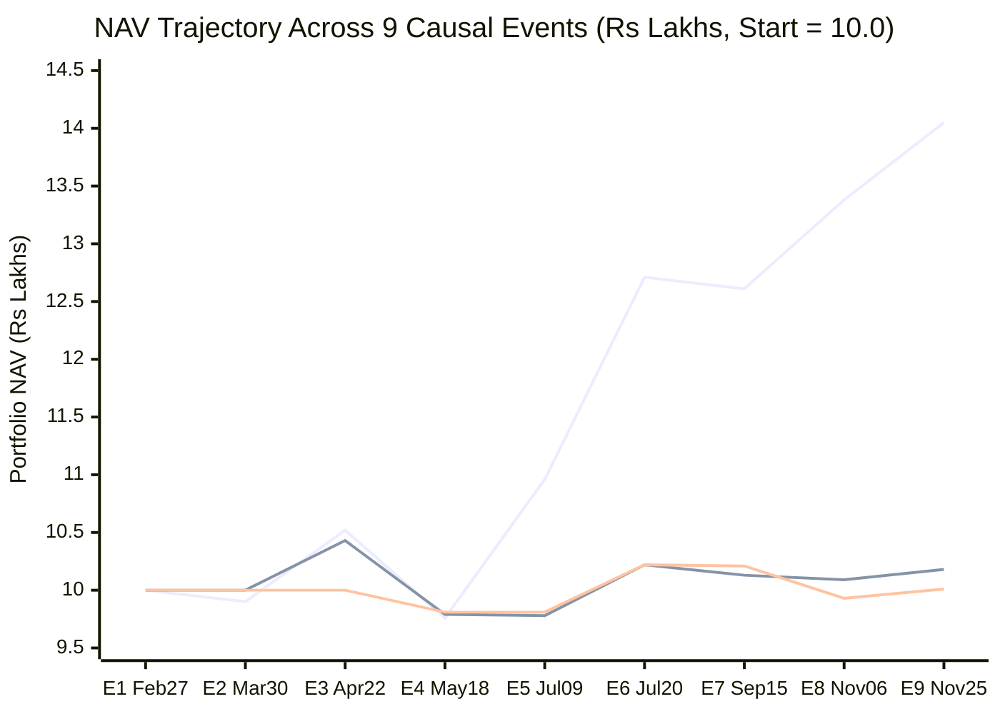

# Live 3-Agent Parallel Blind Event-March: `ULTRACEMCO.NS` & `KALYANKJIL.NS`

**Window:** `2026-02-27` → `2026-11-25` (182 NSE trading sessions, **9 causal dashboard events**)  
**Setup:** Three independent blind expert agents (`mom_trader`, `garp_investor`, `hybrid_pm`) each started with **₹10,00,000** (100% cash, 50% max single-stock cap, 20 bps/side cost). At every causal dashboard event (`E1` → `E9`), all three agents received the **exact same strictly point-in-time (`<= t`) dashboard packet** simultaneously, placed their own orders/stops/triggers, and wrote **live blind critiques of the opposing styles** — with zero knowledge of future prices or each other's books. Daily execution ran deterministically via [sim_multi.py](./sim_multi.py).

> [!TIP]
> **Upgraded Event-Driven Dashboard Feed:** Unlike the earlier monthly-gate single-trader run, this live 3-agent simulation woke up on **real causal dashboard events** (e.g., `Jul 9` Kalyan 200-DMA breakout, `Jul 20` dual breakout, `Nov 6` dual Gate-1 breakout) and exposed **live India VIX**, **SEBI Reg 31 21-day SHP lag + separate FII/DII flows**, **ATR14% & Absolute Delivery (₹ Cr)**, and Valuation v4.1's already-computed **`verdict_raw` + `bear_blend` + `CFO/FCF`** — all strictly causal (`<= t`).

---

## 1. Final Head-to-Head Scorecard (`2026-02-27` → `2026-11-25`)

| Expert Agent / Benchmark | Final NAV | Total Return | Max DD | Sharpe | `ULTRACEMCO` P&L | `KALYANKJIL` P&L | Fills (Wins/Exits) |
|---|---:|---:|---:|---:|---:|---:|---|
| **🥇 Agent 2: GARP & Valuation-Ladder Investor** | **₹14,05,434** | **+40.54%** | −12.89% | **1.920** | **+₹90,193** | **+₹3,15,240** | 10 fills (2/2 wins, 2 open) |
| **🥈 Agent 3: Macro-Regime Hybrid Contrarian PM** | **₹10,17,742** | **+1.77%** | −8.56% | **0.285** | **+₹26,993** | −₹9,251 | 12 fills (2/4 wins, 2 open) |
| **🥉 Agent 1: Momentum & Technicals Swing Trader** | **₹10,00,656** | **+0.07%** | **−5.47%** | 0.046 | −₹27,095 | **+₹27,751** | 8 fills (1/3 wins, 1 open) |
| *Prior Single Blind Trader (Monthly Gates, no VIX/blends)* | *₹9,54,098* | *−4.59%* | *−5.02%* | *−2.097* | *−₹12,583* | *−₹33,319* | *8 fills (0/4 wins)* |
| `BH_50_50` *(Equal-Weight Passive)* | ₹12,80,700 | +28.07% | −17.34% | 1.162 | — | — | Passive 50/50 |
| `BH_KALYANKJIL` *(Buy & Hold)* | ₹15,51,700 | +55.17% | −26.35% | 1.427 | — | +55.17% | `₹410.10 → ₹636.35` |
| `BH_ULTRACEMCO` *(Buy & Hold)* | ₹10,09,700 | +0.97% | −18.26% | 0.184 | +0.97% | — | `₹12,677 → ₹12,800` |
| `NIFTY_50` *(Market Baseline)* | — | +2.54% | −11.70% | 0.300 | — | — | `25,178.65 → 25,819.25` |

Source: [final_3agent_attribution.json](./final_3agent_attribution.json).

> [!IMPORTANT]
> **Headline Result:** **Agent 2 (`GARP & Valuation-Ladder Investor`) crushed even passive 50/50 Buy & Hold by `+12.47pp`** (`+40.54%` vs `+28.07%`) while cutting Max Drawdown by **4.45pp** (`−12.89%` vs `−17.34%`, Sharpe **`1.92`** vs `1.16`). Meanwhile, switching from monthly gates to **causal event-driven checkpoints (`Jul 9` & `Nov 6`)** lifted the pure **Momentum Trader** by **`+4.66pp`** (`−4.59%` → `+0.07%`, Max DD `−5.47%`) and turned `KALYANKJIL` profitable (`+₹27,751`), while **Hybrid PM** beat Momentum on `ULTRACEMCO` by **`+₹54,088`** (`+₹26,993` vs `−₹27,095`)!

---

## 2. Event-by-Event Live Decisions & Cross-Critiques (`E1` → `E9`)

### Side-by-Side Decision Matrix

| Event & Date | Market Pulse | Agent 1: Momentum Trader | Agent 2: GARP Investor | Agent 3: Hybrid Contrarian PM | NAVs @ Event EOD (`Mom / GARP / Hyb`) |
|---|---|---|---|---|---|
| **E1** `2026-02-27` Launch | `CAUTION` · VIX `13.7` · PE `22.0` · Breadth `33%/27%` | **UL:** `TRIGGER` 25% @ `13,120` (gap 2.5%) **KJ:** `AVOID` | **UL:** `WAIT` (`HOLD` P53, wait `≤11,445`) **KJ:** **`BUY_NOW` 20%** (`26% < bear_blend 553`, `NP +90%`) | **UL:** `WAIT` (Stage 3 chop) **KJ:** `TRIGGER` 15% @ `442` (50D reclaim; `VIX 13.7` not washout) | `10.00L` / `10.00L` / `10.00L` |
| **E2** `2026-03-30` Bear Washout | `BEAR` · **VIX `27.89`** · PE `19.6` · Breadth `12.5%` | **UL:** `AVOID` (`ADX 47`, `8 dist_days`) **KJ:** `WAIT` (`Stage 4 VETO`) | **UL:** **`BUY_NOW` 25%** (`ACCUMULATE P28`, `10,745`) **KJ:** **`ADD` → 35%** (`32% < bear_blend`, `1.43×` deliv) | **UL:** **`BUY_NOW` 20%** (stop `9,150`) **KJ:** **`BUY_NOW` 25%** (stop `315`; `VIX 28` washout!) | `10.00L` / `9.90L` / `10.00L` |
| **E3** `2026-04-22` Breadth Thrust | `CAUTION` · VIX `18.3` · **Breadth `82.7%`** · FII `90th%ile` | **UL:** **`BUY_NOW` 30%** (`Gate 1 ON`, stop `11,350`) **KJ:** `WAIT` (`rs1w −7%`) | **UL:** `HOLD` 26.7% (reverted `HOLD` P52) **KJ:** `HOLD` 35.5% (pre-Q4) | **UL:** **`ADD` → 35%** (pyramid, stop `11,220`) **KJ:** `HOLD` 25.7% (**raised stop `315→345`**) | `10.00L` / `10.52L` / `10.43L` |
| **E4** `2026-05-18` Post-Q4 Live | `BEAR` · VIX `19.6` · PE `20.5` · Breadth `66%/38%` | **UL:** `TRIGGER` 25% @ `12,150` (stopped `11,350` today!) **KJ:** `AVOID` (`−15` RS, `DISTRIBUTION`) | **UL:** **`ADD` → 40%** (Q4 **OPM 22%**, `ACCUMULATE P35`) **KJ:** **`ADD` → 45%** (**NP +118%**, `PE 22.3`, `P0.0`) | **UL:** **`TRIM` 35%→22%** (cut pyramid in profit, stop `10,600`) **KJ:** `WAIT` (stopped `May 13 @ 345`!) | `9.81L` / `9.76L` / `9.79L` |
| **E5** `2026-07-09` **KJ 200D Break** | `CAUTION` · VIX `13.4` · Breadth `58%/56%` `MILD BULL` | **UL:** `TRIGGER` 25% @ `11,900` **KJ:** **`TRIGGER` 20% @ `465`** (gap 3%, stop `405`) | **UL:** **`ADD` → 42%** (`Biz 62`, `ACCUMULATE P34`) **KJ:** `HOLD` 50% cap (`+16.8%`, still `< bear_blend`) | **UL:** `HOLD` 22.4% (stop `10,800`) **KJ:** **`TRIGGER` 18% @ `455`** (gap 5%, stop `396`) | `9.81L` / `10.96L` / `9.78L` |
| **E6** `2026-07-20` Dual Breakout | `CAUTION` · VIX `13.0` · Breadth `63%/59%` `MILD BULL` | **UL:** **`BUY_NOW` 30%** (`Gate 1 ON`, MA50 exit) **KJ:** `HOLD` 23% (filled `Jul 13 @ 470.5`, **stop→`475`, trail `15%`**) | **UL:** `HOLD` 37.4% (back at `HOLD P52`) **KJ:** **`TRIM` 56.7%→50%** (cap trim @ `+50%`, RSI 82) | **UL:** **`ADD` → 35%** (pyramid, stop `11,250`) **KJ:** `HOLD` 21% (filled `470.5`, **stop→`480`, trail `15%`**) | `10.22L` / `12.71L` / `10.22L` |
| **E7** `2026-09-15` `BEAR` & Squeeze | `BEAR` · VIX `13.4` · PE `19.5` · Breadth `33%/52%` | **UL:** `AVOID` (MA50 exit `Aug 19 @ 11,499` saved `−7%`) **KJ:** **`ADD` → 40%** (Tight Squeeze, **stop `550`**, trail `11%`) | **UL:** **`ADD` → 45%** (`ACCUMULATE P28`, `DII +1.27%`) **KJ:** **`TRIM` 53.8%→48%** (`+59%`, Jun `DISTRIBUTING`) | **UL:** **`BUY_NOW` 20%** (`10,697` Core Value, stop `9,700`) **KJ:** **`ADD` → 38%** (Tight Squeeze, **stop `538`**, trail `12%`) | `10.21L` / `12.61L` / `10.13L` |
| **E8** `2026-11-06` **Nov Breakout** | `CAUTION` · VIX `17.5` · **FII `100th%ile`** · Both `Gate 1 ON` | **UL:** **`BUY_NOW` 25%** (`Sep ACCUMULATING`, stop `11,580`) **KJ:** **`TRIGGER` 25% @ `611`** (**gap 3%**, stop `548`) | **UL:** `HOLD` 48.4% (`+12.5%`, `DII 20.9%`) **KJ:** **`ADD` 44.3%→49%** (`590.75 < 606.9` trim; **FII `+3.01%`**!) | **UL:** `HOLD` 22.2% (`+15.3%`, **stop→`11,500`**) **KJ:** **`TRIGGER` 30% @ `611`** (gap 4%, stop `540`) | `9.93L` / `13.38L` / `10.09L` |
| **E9** `2026-11-25` **Final (Today)** | **`BULL`** · VIX `17.7` · FII `34.1%` (98th) · Nifty `25,819` | Holds 20 sh **UL** (`+3.06%`); **3% gap-guard skipped KJ `Nov 11` open @ `₹630` (`+3.1%`)!** | Holds 52 sh **UL** (`+15.67%`) + 1,100 sh **KJ** (`+59.67%`) + `₹53,634` banked gains! | Holds 18 sh **UL** (`+18.53%`) + 479 sh **KJ** (`+0.81%`, filled `Nov 11 @ 630`) | **`10.01L` / `14.05L` / `10.18L`** |

---

### Most Instructive Live Blind Cross-Critiques (Recorded *Before* Seeing Future Bars)

1. **Event 1 (`2026-02-27`, `VIX 13.7`):**
   - **Hybrid PM critiqued GARP live:** *"Buying `KALYANKJIL` blindly into `DISTRIBUTION` + 59% vol while `VIX 13.7 / PE 22` signals unfinished market downside risks catching a falling knife."* → **Validated short-term** (Kalyan fell `−16%` to `₹346`), though GARP's small 20% starter size absorbed it cleanly.
2. **Event 2 (`2026-03-30`, `VIX 27.89`, `Breadth 12.5%`):**
   - **GARP & Hybrid PM critiqued Momentum live:** *"At `VIX 27.9` and `12.5%` breadth, chart-only systems scream `Stage 4 / AVOID` and freeze in cash — ceding the highest-asymmetry mean-reversion bottom."* → **Massively validated:** `ULTRACEMCO` rallied `+13.5%` and `KALYANKJIL` `+10.2%` within 3 weeks.
3. **Event 3 (`2026-04-22`, UltraTech `Gate 1 ON @ ₹12,193`):**
   - **GARP critiqued Momentum live:** *"Chart-only traders finally get `ULTRACEMCO` `Gate 1 ON` only AFTER a `+13.5%` bounce back to `40.7× PE` (`HOLD`)!"* → **Validated immediately:** Momentum's `Apr 23 @ ₹12,105` entry stopped out at `₹11,350` (`−6.42%`) on May 18.
4. **Event 4 (`2026-05-18`, Kalyan `₹346.1`, `NP +118%`, `PE 22.3×`):**
   - **Momentum & Hybrid PM critiqued GARP live:** *"Great news (`+118% NP`), awful tape (`DISTRIBUTION`, `CompRS −15.1`) — classic value-trap risk."*
   - **GARP counter-bet (`ADD → 45% @ ₹347.60`):** Treated `cmp_pct 0.0%` (`37.4%` below `bear_blend ₹552.8`) backed by `1.28× FCF/PAT` and `+118%` profit growth as peak dislocation — **turning that single tranche into an `+83%` winner by Nov 25!**
5. **Event 7 (`2026-09-15`, `BEAR` mode + UltraTech `ACCUMULATE P28` + Kalyan Tight Squeeze):**
   - **GARP critiqued Momentum live:** *"Chart traders chase Kalyan's squeeze `59%` above our cost while auto-rejecting UltraTech (`RSI 27.7`) at `P28 ACCUMULATE` and `62%` delivery."* → **Validated on BOTH legs:** Kalyan broke down to `₹498` (though Momentum & Hybrid's smart trailing stops banked `+₹27,751` and `+₹15,567` profits!), while UltraTech surged `+19.7%` from `₹10,697 → ₹12,800`!

---

## 3. Realized Trade Ledgers & Why Each Expert Performed as They Did

### 🥇 Agent 2 — GARP & Valuation-Ladder Investor (`+40.54%`, Max DD `−12.89%`, Sharpe `1.920`)
- **Why It Crushed Both Peers *and* Buy & Hold 50/50 (`+28.07%`):**
  - **UltraTech Cement (`+₹90,193` on a `+0.97%` stock!):** Refused to buy at `HOLD P53` (`₹12,677`), then bought 4 tranches strictly inside `ACCUMULATE` (`Apr 1 @ ₹10,802`, `May 19 @ ₹11,540`, `Jul 10 @ ₹11,584`, `Sep 16 @ ₹10,777` → blended cost **`₹11,065.51`**, ending **`+15.67%`** at `₹12,800`!).
  - **Kalyan Jewellers (`+₹3,15,240`):** Built 3 tranches below `bear_blend ₹552.8` (`Mar 2 @ ₹394.95`, `Apr 1 @ ₹385.60`, `May 19 @ ₹347.60` → avg `₹379.22`), **banked `+₹53,634`** via cap-hygiene trims at `₹568` (`Jul 21`, `+49.8%`) and `₹606.9` (`Sep 16`, `+60.0%`), and bought `97` sh back at `₹597` (`Nov 8`) once `Sep 2026` SHP confirmed FIIs surging back `+3.01pp`!
- **Key Risk to Remember:** With zero hard stops, GARP relies completely on **fundamental/cash-flow verification** (`1.28× FCF/PAT`, `21% ROCE`, `Biz 72→75`). Had Kalyan been a genuine governance fraud instead of a mispriced grower, an unhedged `45%` average-down would have been catastrophic.

### 🥈 Agent 3 — Macro-Regime Hybrid Contrarian PM (`+1.77%`, Max DD `−8.56%`, Sharpe `0.285`)
- **What Worked Brilliantly:**
  - **UltraTech (`+₹26,993` vs Momentum's `−₹27,095` — a `+₹54,088` outperformance!):** Used `VIX 27.89` (`Mar 30`) and `ACCUMULATE P28 + DII +1.27pp` (`Sep 15`) to buy `₹10,802` and `₹10,777`, riding its current 18-share Core Value sleeve at **`+18.53%` (`+₹36,026` unrealized)**.
  - **Kalyan July–Oct Swing (`+₹15,567`):** Caught `Jul 13 @ ₹470.50` via Event 5's `₹455` trigger, pyramided `Sep 16`, and exited profitably via `TRAIL_12%_HIT @ ₹553.15` on `Oct 1` (`+4.86%`).
- **The One Costly Mistake (`−₹27,256`):** At Event 3 (`Apr 22`), Hybrid PM **raised its Core-Value catastrophe stop on Kalyan from `₹315 → ₹345`**. That tightened stop got clipped on `May 13 @ ₹345.0` (`−10.71%`), just `₹14` above the `₹330.8` bottom! **Rule learned:** *Never put a momentum stop on a Core-Value sleeve.*

### 🥉 Agent 1 — Momentum & Technicals Swing Trader (`+0.07%`, Max DD `−5.47%`, Sharpe `0.046`)
- **Huge Upgrade from Event-Driven Alerts & Gap-Guard (`−4.59%` → `+0.07%`):**
  - **Kalyan (`+₹27,751`):** Waking up on **Event 5 (`Jul 9` 200-DMA breakout)** let Momentum arm `TRIGGER@465`, fill cleanly at `₹470.50`, widen trail to `15%`, pyramid into the Tight Squeeze, and lock in **`+₹27,751` (`+8.09%`)** via `TRAIL_11%_HIT @ ₹566` (`Sep 29`). Then on `Nov 11`, its **`3.0%` gap-guard (`SKIP: 3.1% > 3.0% @ ₹630`)** kept it from buying a late gap near the top!
  - **Where Momentum Bled (`−₹27,095` on UltraTech):** Buying `ULTRACEMCO` *only* after `+13%` rebounds into `Gate 1 ON` (`Apr 23 @ ₹12,105` → stopped `₹11,350` `−6.42%`; `Jul 21 @ ₹12,070` → MA50 exited `₹11,499` `−4.92%`) proved that **low-vol cyclical large-caps whipsaw breakout traders in choppy markets**.

---

## 4. Practical Blueprint: How to Combine All 3 Agents Inside Our Dashboard

| Stock Archetype | Best Dashboard Playbook (Proven Live) | Entry Signals to Use | Risk / Exit Rule |
|---|---|---|---|
| **Large-Cap Cyclical Compounder** *(e.g. `ULTRACEMCO.NS`: low vol `18–26%`, `HEALTHY` Biz, cyclical swings)* | **GARP / Valuation-Ladder Sleeve** (`+₹90.2k` GARP / `+₹27.0k` Hybrid vs `−₹27.1k` Momentum) | Scale 2–3 tranches when `Valuation = ACCUMULATE` (`< ladder.accumulate`, `P <= 35`), `VIX > 20` or `RSI < 35`, and **DII ownership rising** (`dii_q > 0`) | **Do NOT use MA50/tight stops.** Hold to `fair_hi` / `trim` or exit only on fundamental breakdown (`Biz < 45` / hard flags). |
| **High-Growth High-Beta Compounder** *(e.g. `KALYANKJIL.NS`: `vol 40–80%`, `Biz 72–75`, `NP +60–118%`, `FCF/PAT > 1.0`)* | **Barbell: Core GARP Starter + Event-Driven Stage-2 Pyramid** | **Core (20–30%):** Deep dislocation (`CMP < bear_blend` + `FCF/PAT > 0.8` + `NP > +30%`), catastrophe stop only. **Momentum Add (+15–20%):** Event alert on **200-DMA breakout** (`Jul 9`) with `3%` gap-guard + `2.5–3.0× ATR14` trail | Keep Core sleeve un-whipsawed; trail ONLY the Momentum pyramid (`12–15%` or `3× ATR14`), and cap-rebalance above 50% into `RSI > 80`. |

Full raw event packets, orders, daily equity curves, and execution logs are stored under [time_march_3agents](./final_3agent_attribution.json).
