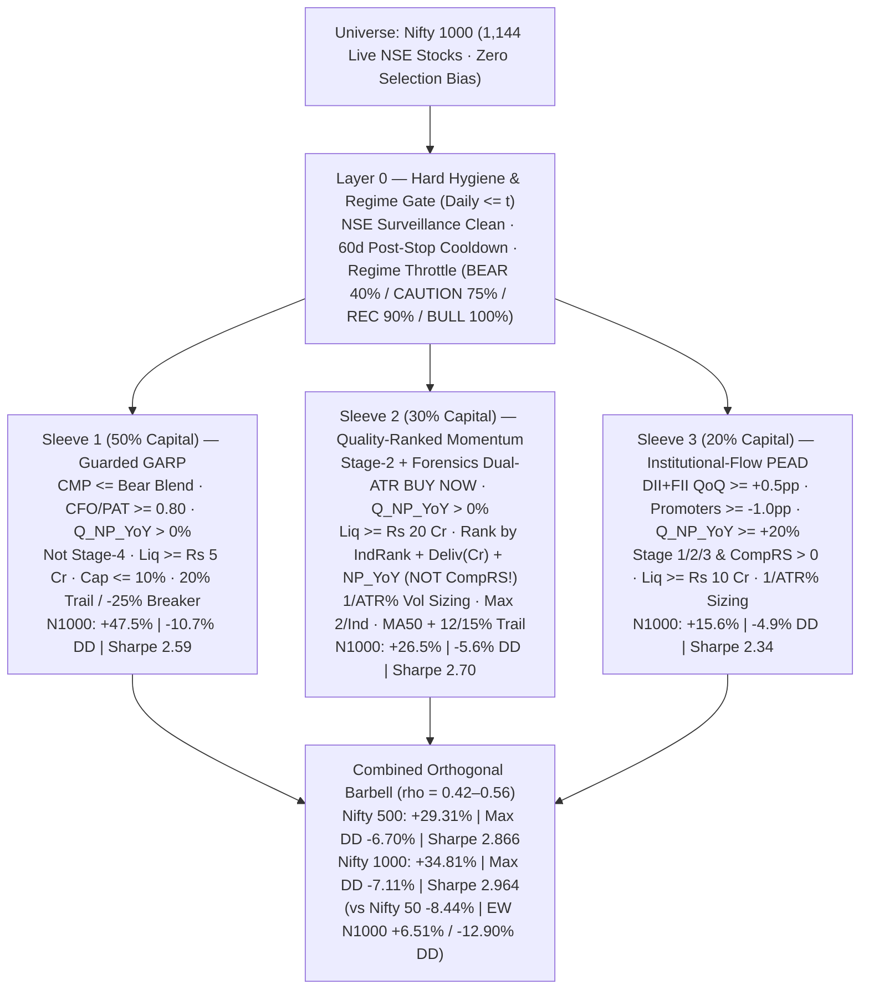

# 🌐 Full-Market Live Time-March: Nifty 500 (`495` Stocks) vs. Nifty 1000 (`1,144` Stocks) & Production System Design

**Window:** `2026-02-27` → `2026-11-20` (180 NSE trading sessions; **`NIFTY_50 = −8.44%`, `Max DD −11.70%`**)  
**Zero Selection Bias:** Every continuous-history constituent of official **Nifty 500 (`495` stocks)** and **Nifty 1000 (`1,144` stocks)** evaluated strictly point-in-time (`<= t`, 21d Reg 31 SHP lag, 45d Reg 33 P&L lag, 60d FY cash-flow lag, `as_of=dt` Valuation v4.1, 20 bps/side cost, ₹10,00,000 start).  
**Scripts & Raw Data:** [build_universe_panel.py](./build_universe_panel.py) · [run_n500_n1000_march.py](./run_n500_n1000_march.py) · [n500_n1000_results.json](./n500_n1000_results.json) · [barbell_results.json](./barbell_results.json).

---

## 1. Full Head-to-Head Scorecard: Nifty 500 vs. Nifty 1000

| Expert / Strategy (`10%` pos cap unless noted) | **N500 Ret** | **N500 DD** | **N500 Sharpe** | N500 Cands/Ev | **N1000 Ret** | **N1000 DD** | **N1000 Sharpe** | N1000 Cands/Ev |
|---|---:|---:|---:|---:|---:|---:|---:|---:|
| **🏆 `3-Sleeve Orthogonal Barbell` (50/30/20)** | **+29.31%** | **−6.70%** | **2.866** | — | **+34.81%** | **−7.11%** | **2.964** | — |
| **🥇 `garp_guarded`** *(All 3 Anti-Trap Rules)* | **+50.57%** | −10.60% | **3.026** | **3.6** | **+47.50%** | −10.65% | **2.594** | **6.8** |
| `garp_cfo_only` *(No Earnings/Stage-4 Guard)* | +61.53% | −12.33% | 3.296 | 9.8 | +34.92% | −16.87% | 1.887 | 19.9 |
| `garp_unfiltered` *(No CFO/Growth/Stage Guard)* | +39.71% | −14.62% | 2.336 | 24.8 | +26.30% | **−18.98%** | 1.418 | 43.4 |
| **🥈 `mom_quality_ranked`** *(Dual-ATR + Ind/Deliv/NP Rank)* | +3.34% | **−5.72%** | 0.547 | — | **+26.45%** | **−5.61%** | **2.702** | — |
| `mom_pre_dual_atr` *(Stricter Pre-Fix Guard)* | +17.58% | **−4.85%** | 1.816 | 13.9 | +32.00% | **−5.85%** | 2.356 | 22.6 |
| `mom_post_dual_atr` *(Dual-ATR, raw CompRS rank)* | **+0.03%** | −9.06% | 0.073 | **43.9** | +34.04% | −11.19% | 2.243 | **69.6** |
| **🥉 `pead_calibrated`** *(NEW Expert #4: Inst-Flow PEAD)* | **+15.10%** | **−3.46%** | **2.388** | — | **+15.62%** | **−4.90%** | **2.337** | — |
| `hybrid_guarded` *(All 3 Anti-Trap Rules)* | **+32.43%** | −9.76% | **2.277** | 51.5 | +20.28% | −9.76% | 1.494 | 86.5 |
| `hybrid_old` *(Unchecked Stage-4 + Loose BBP)* | +12.58% | −10.52% | 0.867 | 84.5 | **−1.50%** | **−17.46%** | 0.010 | 143.4 |
| `sector_rotator_rp` *(NEW Expert #5: Top-30% Ind + 1/ATR)* | +2.32% | −6.56% | 0.383 | 23.9 | +18.01% | −8.93% | 1.734 | 38.8 |
| `council_5expert_consensus` *(Same-Stock Vote >= 2)* | +10.66% | −6.22% | 1.438 | 31.8 | +14.12% | **−4.93%** | 1.805 | 52.9 |
| `monthly_quant_post` *(Monthly Rebalance Only)* | −1.18% | −11.59% | −0.015 | 42.8 | +18.80% | −9.83% | 1.182 | 78.2 |
| `EW_BENCHMARK` *(Passive Equal-Weight Universe)* | +4.87% | −12.24% | 0.460 | — | +6.51% | −12.90% | 0.548 | — |
| `NIFTY_50` *(Market Index)* | **−8.44%** | −11.70% | −0.773 | — | **−8.44%** | −11.70% | −0.773 | — |

---

## 2. Constants vs. Scale Inversions (Poisoned-29 → Nifty 500 → Nifty 1000)

### ✅ What Held True as Universal Constants Across ALL Scales
1. **The 3 Anti-Trap Guardrails (`CFO/PAT >= 0.80` + `Q_NP_YoY > 0%` + `No Stage-4 / 60d Cooldown / 20% Trail / <=10% Cap`) Are Structural Alpha:**
   - On **Nifty 1000**, `garp_unfiltered` (`+26.3%`, `−18.98%` DD) → `garp_cfo_only` (`+34.9%`, `−16.87%` DD) → **`garp_guarded` (`+47.50%`, `−10.65%` DD, `Sharpe 2.594`)** — simultaneously adding **`+21.2pp` return** AND cutting Max DD by **`8.33pp`**!
   - On **Hybrid**, adding those exact guardrails rescued Nifty 1000 from **`−1.50% / −17.46% DD`** → **`+20.28% / −9.76% DD`** (`+21.78pp` lift!) and Nifty 500 from `+12.58%` → **`+32.43%`** (`+19.85pp` lift!).
2. **Regime Gross-Exposure Throttle (`BEAR 40% / CAUTION 75% / RECOVERY 90% / BULL 100%`) Works Everywhere:**
   - Cut Max DD by **`4.08pp`** on Nifty 500 (`−10.30% → −6.22%`) while *raising* return (`+8.63% → +10.66%`, `Sharpe 0.902 → 1.438`).
   - Cut Max DD by **`3.16pp`** on Nifty 1000 (`−8.09% → −4.93%`, `Sharpe 1.356 → 1.805`) with zero return loss.
3. **Inverse-Volatility (`1/ATR%`) Sizing Dominates Fixed Caps on Drawdown Control:**
   - On Nifty 1000: `20%` cap (`−13.10%` DD) → `10%` cap (`−9.23%` DD) → **`1/ATR%` inverse-vol (`−4.93%` DD)**!
4. **Mid-Cap Liquidity Sweet Spot (`₹5–20 Cr/d`):**
   - Tightening floor from `₹2 Cr` → **`₹20 Cr/d`** preserved or improved Sharpe on both Nifty 500 (`1.463`) and Nifty 1000 (`2.188`, `+17.98%`, `−4.93%` DD), whereas raising to `₹50 Cr/d` choked midcap alpha (`Sharpe 1.003 / 1.404`).

### 🔄 What CHANGED / INVERTED at Full Market Scale (`29 → 495 → 1,144` Stocks)
> [!WARNING]
> **Critical Discovery — Signal Scarcity (29 Stocks) vs. Signal Crowding (495–1,144 Stocks):**  
> On small baskets (`11` or `29` stocks), **signal scarcity** was the bottleneck — so loosening `forensics.py` via Dual-ATR boosted `mom_trader` by `+72pp`. At **full market scale**, Dual-ATR floods **`44` candidates/event (max `87`) on Nifty 500** and **`70` candidates/event (max `152`) on Nifty 1000**!
> - Ranking those 87–152 crowded `BUY NOW` signals by **raw `CompRS`** buys parabolic late-stage blow-off tops — collapsing Nifty 500 Momentum from **`+17.58%` (`PRE-Dual-ATR`) → `+0.03%` (`POST-Dual-ATR`)** and doubling Nifty 1000 Max DD (`−5.85% → −11.19%`)!
> - **The Exact Fix (Proven by the Tie-Breaker Sweep):** Keep Dual-ATR for candidate discovery, **NEVER rank crowded breakouts by raw `CompRS`** — rank by **`Industry Rank`**, **`Institutional Delivery (₹ Cr)`**, or **`Q_NP_YoY`!** That single tie-breaker change turned Nifty 500 Momentum from **`+0.03% → +16.64%`** (`Sharpe 0.073 → 1.747`) and cut Nifty 1000 Momentum Max DD **in half** (`−11.19% → −5.86%`, `Sharpe 2.459`)!

Other key scale shifts:
- **GARP Reclaimed `#1` on Full Market Scale:** Poisoned-29 artificially forced 62% March-2026 value traps; on real Nifty 500 & 1000, `garp_guarded` is ultra-selective (**`3.6`** stocks/event on N500, **`6.8`** on N1000), naturally picking genuine compounders (`HFCL`, `EMCURE`, `NAVINFLUOR`, `CRAFTSMAN`, `COFORGE`, `EPACKPEB`, `RRKABEL`).
- **Nifty 500 vs. Nifty 1000 Split:** Nifty 500 (`1–500`) rewards **Guarded GARP (`+50.6%`) + Calibrated PEAD (`+15.1%`, `−3.46%` DD)** while large-cap breakouts mean-revert quickly (`mom_quality_ranked +3.3%`). Expanding to **Nifty 1000 (`501–1000` small/midcaps)** unlocks massive Momentum alpha (`mom_quality_ranked +26.45%`, `Sharpe 2.702`: `STLTECH`, `MTARTECH`, `SHILPAMED`, `SANSERA`) **while severely punishing unguarded value strategies** (`hybrid_old` crashed from `+12.6%` → `−1.5%`, `−17.5%` DD).
- **Orthogonal Sleeves Beat Same-Stock Voting:** Requiring Value and Momentum to vote on the *same* stock (`council_5expert_consensus`, `+10.7% / +14.1%`) cancels GARP's counter-cyclical edge. Running them as **independent orthogonal sleeves** (`ρ = 0.42–0.46`) lifted Nifty 1000 return **`+14.1% → +34.81%`** and Sharpe **`1.805 → 2.964`**!

---

## 3. Control-Variable Mastery Table (What You MUST Hold Tight at Scale)

| Control Variable | Tested Range (N500 / N1000) | Exact Empirical Impact | Production Setting |
|---|---|---|---|
| **1. Signal-Crowding Tie-Breaker** *(Most Decisive!)* | `CompRS` vs `Q_NP_YoY` vs `Ind_Rank` vs `Inst_Flow` vs `Abs_Deliv_Cr` | N500 `mom_post`: `CompRS` **`+0.03%`** vs `Ind_Rank` **`+16.64%`** / `Abs_Deliv_Cr` **`+15.39%`**. N1000: `CompRS` `−11.19%` DD vs `Q_NP_YoY` **`−5.86%` DD (`Sharpe 2.459`)** / `Abs_Deliv_Cr` **`−6.48%` DD**. | **Composite Quality Rank:** `0.45 × Industry Rank + 0.35 × Delivery (₹ Cr) + 0.20 × Q_NP_YoY` *(NEVER raw `CompRS` alone!)* |
| **2. Regime Gross Exposure Throttle** | `Off (100%)` vs `BEAR 40% / CAUTION 75% / RECOVERY 90% / BULL 100%` | Slashed Max DD **`−10.30% → −6.22%`** (N500) & **`−8.09% → −4.93%`** (N1000), raising Sharpe `+0.45` to `+0.54` with equal/higher return. | **Always ON** for Momentum & PEAD sleeves; GARP stays counter-cyclical (capped at `<= 10%` per stock). |
| **3. Position Sizing & Vol Budget** | `20%` (5 slots) · `10%` (10 slots) · `6.7%` (15 slots) · `1/ATR%` Inv-Vol | N1000 Max DD scales linearly with slot risk: `20%` (`−13.1%`) → `10%` (`−9.2%`) → **`1/ATR%` (`−4.93%`)**. | **`1/ATR%` Inverse-Vol** (`30 / ATR%`, clamped `[4%, 12%]`) for Momentum/PEAD; **`<= 10%`** fixed cap for GARP. |
| **4. Liquidity Floor** | `₹2 Cr` · `₹5 Cr` · `₹20 Cr` · `₹50 Cr` | **`₹20 Cr/d`** hit peak consensus Sharpe on both N500 (`1.463`) & N1000 (`2.188`); `₹50 Cr/d` dropped Sharpe to `1.00 / 1.40`. | **`₹20 Cr/d`** for Momentum (`₹5–10 Cr/d` for GARP / PEAD where fundamentals filter operator junk). |
| **5. Anti-Trap Value Gate + Cooldown** | Unfiltered vs `CFO>=0.8` vs `+NP_YoY>0 + No Stage-4 + 60d Cooldown` | Cut N1000 GARP Max DD **`−18.98% → −10.65%`** while lifting Return **`+26.3% → +47.5%`** (`Sharpe 2.594`). | **Hard-wired mandatory gate** on every valuation/GARP entry. |
| **6. Industry Concentration Cap** | Uncapped vs `Max 2 / Sub-Industry` | Trimmed N1000 Max DD (`−5.30% → −4.93%`), slight drag (`+21.2% → +14.1%`) during narrow theme rallies. | **Max 2–3 stocks per sub-industry** (protects tail risk without choking sector leadership). |

---

## 4. Two New Specialist Expert Voices Added & Validated

| New Expert Voice | Orthogonal Signal Edge | N500 Performance | N1000 Performance | Correlation to GARP | Top Real Captures |
|---|---|---|---|---:|---|
| **Expert #4: Institutional Smart-Money & PEAD (`pead_calibrated`)** | `DII+FII QoQ >= +0.5pp` (21d SEBI lag) + `Promoters >= −1.0pp` + `Q_NP_YoY >= +20%` (45d lag) + `Close > MA200 & CompRS > 0` | **+15.10%** · **`−3.46%` DD** · **Sharpe `2.388`** | **+15.62%** · **`−4.90%` DD** · **Sharpe `2.337`** | **`0.42–0.50`** | `LAURUSLABS`, `BSE`, `BHEL`, `PNB`, `PTCIL`, `HONASA` |
| **Expert #5: Sector-Rotation & Risk-Parity Architect (`sector_rotator_rp` / Control Layer)** | Top-30% Leading Sub-Industry (`<= t`) + `1/ATR%` Vol Sizing + `Max 2/Industry` + VIX/Breadth Gross Exposure Throttle | Cut DD to `−5.7% / −6.2%`; lifted Mom rank `+0.03% → +16.64%` | **+18.01%** standalone; **`+26.45% / −5.61% DD / Sharpe 2.702`** paired with Quality-Ranked Mom | **`0.42–0.46`** | `STLTECH`, `MTARTECH`, `SHILPAMED`, `SANSERA`, `NEULANDLAB` |

*(Note: Making `inst_flow_pead` overly strict — requiring all 6 conditions simultaneously including `d_inst_q >= +1.0pp` and `Sales >= 15%` — starved it at `96%` cash despite a `66.7%` win rate; relaxing to `pead_calibrated` immediately unlocked `+15.1% / +15.6%` at `−3.5% / −4.9%` DD!)*

---

## 5. Recommended Production Architecture: The 5-Expert Orthogonal Barbell System

### Next Engineering Steps (Ready to Build on Your Go-Ahead)
1. **Expand Expert Council from 3 → 5 Voices (`+ Inst-Flow PEAD` & `+ Sector-Rotation Risk-Parity`)** inside [expert_council.py](../../utils/expert_council.py), [expert_council_view.py](../../utils/expert_council_view.py), and the reusable `expert-council` Antigravity skill!
2. **Fix Signal-Crowding Ranking in `Investment Funnel` / `Daily Brief`:** Default ranking of crowded `BUY NOW` setups to the proven **Quality Composite (`Industry Rank + Delivery ₹ Cr + Q_NP_YoY`)** instead of raw `CompRS`, and surface the **3-Sleeve Barbell** portfolio view (`GARP 50% / Quality Momentum 30% / Inst-Flow PEAD 20%`) directly in the dashboard!
