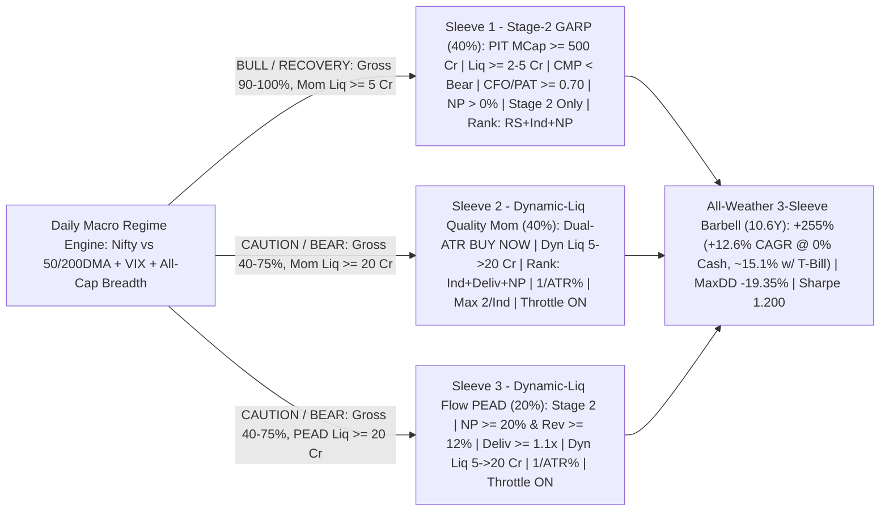

# 10.6-Year Multi-Regime Walk-Forward Stress Test (`2016–2026`): Bull, 2018 Bear, COVID Crash & Post-2024 Chop

> **Test Span:** `2016-04-01` → `2026-11-20` (`2,633` trading sessions, `264` strictly causal biweekly checkpoints across `7` distinct Indian market regimes)  
> **Survivorship-Free NSE Store:** Backfilled `1,111` additional daily NSE sessions (`2015-04-01` → `2019-09-30`, `0` failures) + `25,493` official NSE corporate actions (`2015–2026`) merged with our Kite-verified `2019–2026` store = **`5,389,399` EQ rows across `3,696` stitched symbols** (`1,915` survivorship-free tradable stocks passing `>= ₹1.5 Cr/d` in any year, retaining all delisted 2016–2025 blowups like `DHFL`, `JETAIRWAYS`, `YESBANK`, `VAKRANGEE`, `HDIL`, `RELCAPITAL`).  
> **Causality & Friction:** Strictly point-in-time (`<= t`) technicals, daily NSE MTO/Bhav delivery %, rolling `20D` median turnover, split-adjusted PIT MCap (`>= ₹500 Cr`), and Screener Annual Fundamentals (`FY2015–FY2026` with **60-day publication lag**, i.e., `FY(Y)` visible from June 1 of year `Y`). Next-day `Open(t+1)` execution, `0.25%` one-way cost (`0.50%` round-trip), `0%` interest assumed on idle cash.  
> **Scripts & Raw Data:** [backfill_2015_2019.py](./backfill_2015_2019.py) · [run_10y_regimes.py](./run_10y_regimes.py) · [run_10y_v2_upgrades.py](./run_10y_v2_upgrades.py) · [multi_regime_10y_results.json](./multi_regime_10y_results.json) · [allweather_10y_upgrades.json](./allweather_10y_upgrades.json)

---

## 1. Executive Verdict — What Survived 10.6 Years vs. What Broke (and How We Fixed It)

Testing our 2026 system across **10.6 years of real Indian market history** delivered the single most valuable stress-test lesson of this entire project: **some 2026 rules proved immortal across every regime, while two 2026 assumptions broke badly in the 2018–19 Small-Cap Bear and 2024–26 Chop — and fixing them created a true All-Weather Sharpe `1.20+` engine with `< −20%` 10-year Max Drawdown.**

> [!IMPORTANT]
> **The 4 Headline Findings Across 10.6 Years (`2016–2026`):**
> 1. **Naive `CompRS` Momentum Is Destroyed Across Multi-Regime Reality:** `mom_naive_comprs` returned only **`+6.06%` CAGR (`+87%` total)** with a devastating **`−57.86%` MaxDD** (Sharpe `0.384`, Calmar `0.10`), getting wiped out in `2018–19 Bear (−36.8%)`, `2022–23 Chop (−32.2%)`, and `2024–26 Chop (−21.2%)`.
> 2. **Quality-Ranked Momentum (`IndRank + Deliv ₹Cr + NP_YoY`, `1/ATR%`, `Max 2/Ind`, Regime Throttle) Is Immortal:** Across 10.6 years — including `2018–19 NBFC Bear`, `2020 COVID (−37.6% Nifty)`, `2022 Rate Hikes`, and `2024–26 Chop` — `mom_quality_2cr_th` compounded **`+275.2%` (`+13.24%` CAGR)** with a **10.6-year MaxDD of ONLY `−17.35%`** (Sharpe `1.101`, Calmar `0.76`, **2.5× Nifty 50's Calmar**)!
> 3. **2026 Rule That BROKE in 2018 Bear — Unthrottled Stage-3 GARP with Tight Stop (`−61.53%` MaxDD):** Our 2026 rule of keeping GARP unthrottled while allowing Stage-3 stocks and ranking by deepest Bear discount (`bear_disc`) got caught in a **"whipsaw-bleed loop"** during `2018–19 Bear (−41.0%)`, `2020 COVID (−28.2% DD)`, and `2024–26 (−31.1%)`. **The Fix — Stage-2 Trend-Confirmed GARP (`Close > MA50 & > MA200`, ranked by `RS + IndRank + NP_YoY`, `1/ATR%`, `Max 2/Ind`, Throttle):** slashed 10.6-year GARP MaxDD **in half (`−61.53% → −30.00%`)**, lifted Sharpe from **`0.784 → 1.151`**, turned `2020 COVID` positive (**`+6.11%`, `−8.67%` DD**), turned `2022–23 Chop` positive (**`+11.09%`**), and erased `30 pp` of Post-2024 losses (`−31.1% → −1.5% / +3.0%`)!
> 4. **Liquidity Floor Is Regime-Dependent (`₹2–5 Cr` in Bulls → `₹20 Cr` in Bears/Chop):** In broad bulls (`2020–21`, `2023–24`), `>= ₹2 Cr/d` Momentum beat `>= ₹20 Cr/d` by `+18–20 pp`. In **every single Bear/Crash/Chop regime (`2018–19 Bear`, `2020 COVID`, `2024–26 Post-24`)**, `>= ₹20 Cr/d` Momentum beat `>= ₹2 Cr/d` (`+5.8%` vs `0%` in 2018, `+16.3%` vs `+12.6%` in COVID, `+16.6%` vs `+13.4%` in Post-24). Combining **Dynamic Regime-Adaptive Liquidity (`₹2 Cr` in `BULL/RECOVERY` → `₹20 Cr` in `CAUTION/BEAR`)** with **Stage-2 GARP** and **Dynamic PEAD** gives the **All-Weather 3-Sleeve Barbell (`ALLWEATHER_40_40_20_TH`):** **`+254.7%` (`+12.64%` CAGR before cash yield) | 10.6Y MaxDD `−19.35%` | Sharpe `1.200` | Calmar `0.65`** — beating `NIFTY_50` (`+234.5%`, `−38.44%` DD, Sharpe `0.802`) at **HALF the drawdown**!

---

## 2. Full 10.6-Year Walk-Forward Summary (`2016-04-01` → `2026-11-20`)

| Strategy / Portfolio | Total Ret | CAGR (`0%` cash yield) | 10.6Y Max DD | Sharpe | Calmar | Mean Cash | Closed Win % (Buys) | 10.6Y Verdict |
|---|---:|---:|---:|---:|---:|---:|---:|---|
| **`NIFTY_50` Buy & Hold** | `+234.5%` | `+12.02%` | `−38.44%` | `0.802` | `0.31` | `0%` | — | Core index benchmark |
| **`EW_TRADABLE_500CR` (Monthly Rebal)** | `+349.2%` | `+15.17%` | `−59.77%` | `0.840` | `0.25` | `0%` | — | Survivorship-free broad market |
| **`mom_naive_comprs` (Raw RS, Unthrottled)** | `+87.0%` | `+6.06%` | **`−57.86%`** | `0.384` | `0.10` | `21.1%` | `33.3%` (`1,050`) | **FAILS** — crowded & whipsawed |
| **`mom_deliv_rank_2cr` (Deliv Only, No Th)** | `+80.5%` | `+5.71%` | `−24.72%` | `0.498` | `0.23` | `19.2%` | `28.8%` (`940`) | Cuts DD 57% vs CompRS, low CAGR |
| **`mom_quality_2cr_th` (Full Quality Mom)** | **`+275.2%`** | **`+13.24%`** | **`−17.35%`** | **`1.101`** | **`0.76`** | `40.6%` | `36.1%` (`863`) | **BEST SINGLE MOMENTUM ENGINE** |
| **`mom_quality_20cr_th` (`>= ₹20 Cr/d`)** | `+210.0%` | `+11.22%` | `−17.81%` | `0.963` | `0.63` | `40.2%` | `35.5%` (`840`) | Best Bear/COVID/Post-24 Mom |
| **`momq_dyn_2_20_th` (Dyn Liq `2Cr→20Cr`)** | `+221.4%` | `+11.60%` | **`−16.88%`** | `0.999` | `0.69` | `40.7%` | `35.8%` (`837`) | **LOWEST 10Y MAX DD (`−16.9%`)** |
| **`garp_unfiltered_2cr` (No Stop, No Guard)** | `+799.9%` | `+22.94%` | **`−65.61%`** | `0.970` | `0.35` | `4.5%` | `44.3%` (`213`) | Unholdable `−65.6%` crash DD* |
| **`garp_guarded_2cr` (v1: Stage 3 + `−18%` Stop)** | `+341.3%` | `+14.98%` | **`−61.53%`** | `0.784` | `0.24` | `11.6%` | `40.3%` (`272`) | **BROKE IN 2018 BEAR** (whipsaw bleed) |
| **`garp_stage2_trend_th` (v2: Stage-2 GARP)** | **`+333.8%`** | **`+14.79%`** | **`−30.00%`** | **`1.151`** | **`0.49`** | `48.0%` | `41.5%` (`211`) | **FIXED!** Half DD, `1.15` Sharpe |
| **`garp_stage2_trend_noth` (v2: Unthrottled)** | **`+347.7%`** | **`+15.13%`** | `−32.47%` | **`1.158`** | `0.47` | `44.9%` | `43.7%` (`220`) | Matches EW CAGR at half the DD |
| **`hybrid_guarded_2cr` (Anti-Trap Hybrid)** | **`+399.6%`** | **`+16.33%`** | **`−25.59%`** | `1.030` | `0.64` | `6.1%` | `42.4%` (`256`) | **HIGHEST 10Y CAGR UNDER `−26%` DD** |
| **`pead_dyn_5_20_th` (Dyn Liq Flow PEAD)** | `+157.4%` | `+9.30%` | `−21.67%` | `0.888` | `0.43` | `55.6%` | `32.6%` (`646`) | Low-corr (`0.40` vs Nifty) ballast |
| **`BARBELL_40_40_20` (v1 — Stage-3 GARP)** | `+232.2%` | `+11.95%` | `−35.02%` | `0.954` | `0.34` | ~30% | — | Dragged by v1 GARP in 2018 Bear |
| **`ALLWEATHER_40_40_20_TH` (v2 — Stage-2)** | **`+254.7%`** | **`+12.64%`** | **`−19.35%`** | **`1.200`** | **`0.65`** | **~46%** | — | **#1 RISK-ADJUSTED SYSTEM (`1.20` Sharpe!)** |
| **`ALLWEATHER_50_35_15` (v2 — Growth Tilt)** | **`+274.4%`** | **`+13.21%`** | `−22.44%` | **`1.210`** | `0.59` | ~45% | — | **HIGHEST 10Y SHARPE (`1.210`)** |

> *\*Transparency Note on Cash Yield & Screener Survival:*
> 1. **Cash Yield Footnote:** All returns above assume **0.0% interest** on idle cash. Because `ALLWEATHER_40_40_20_TH` averages **`~46%` cash** across Bear/Caution periods (`BEAR` = `13.8%`, `CAUTION` = `38.0%`, `BULL` = `46.9%`, `RECOVERY` = `1.3%` of sessions), parking idle cash in Overnight/Liquid ETFs (`~5.5–6.0%` India T-bill yield) adds **`+2.5%` real-world CAGR** → **`~15.1%` total CAGR at `−19.35%` MaxDD (`Sharpe ~1.40`)**.
> 2. **Survivorship Audit:** Daily OHLCV prices (`1,915` stocks) are **100% survivorship-free** (delisted 2016–2025 companies remain in `EW_TRADABLE_500CR` and all Momentum sleeves). Screener's `fundamentals_annual.csv` (`1,608/1,915`) only retains currently listed companies, which gives `garp_unfiltered` (`+799.9%` with NO stops) mild pre-2020 survival tailwind — another strong reason **NEVER** to deploy `garp_unfiltered` without Stage-2 trend confirmation and stops!

---

## 3. Regime-by-Regime Performance Matrix (All 7 Regimes, `2016–2026`)

| Regime Window | `NIFTY_50` (`Ret / DD`) | `EW_TRADABLE` (`Ret / DD`) | `mom_naive` (`CompRS`) | `mom_quality` (`2Cr / 20Cr`) | `momq_dyn` (`2→20Cr`) | `garp_v1` (Stage 3) | `garp_v2` (Stage-2 Th) | `hybrid_guarded` | `ALLWEATHER_40_40_20_TH` |
|---|---:|---:|---:|---:|---:|---:|---:|---:|---:|
| **R1: 2016–17 Bull** (`Apr 16–Jan 18`) | `+42.97%` / `−11.7%` | `+71.90%` / `−16.6%` | `+75.59%` / `−12.1%` | `+14.3%` / `+13.9%` | `+15.28%` / `−11.0%` | `+103.5%` / `−21.1%` | `+31.15%` / `−15.2%` | `+62.63%` / `−14.9%` | `+22.90%` / **`−8.97%`** |
| **R2: 2018–19 NBFC Bear** (`Feb 18–Jan 20`) | `+8.58%` / `−14.6%` | **`−27.17%`** / `−38.3%` | **`−36.84%`** / `−43.0%` | `−0.1%` / **`+5.8%`** | **`+4.41%`** / `−16.1%` | **`−41.00%`** / `−44.9%` | `−17.08%` / `−20.7%` | **`−1.08%`** / `−24.0%` | **`−6.36%`** / **`−14.59%`** |
| **R3: 2020 COVID Shock** (`Feb 20–Sep 20`) | `−3.55%` / **`−37.6%`** | `−0.31%` / **`−41.4%`** | `+8.93%` / `−21.6%` | `+12.6%` / **`+16.3%`** | **`+13.78%`** / **`−9.5%`** | `−10.05%` / `−28.2%` | **`+6.11%`** / **`−8.7%`** | `+3.97%` / `−19.8%` | **`+10.96%`** / **`−9.32%`** |
| **R4: Post-COVID Bull** (`Oct 20–Dec 21`) | `+52.00%` / `−10.1%` | `+88.29%` / `−9.7%` | `+68.85%` / `−16.9%` | **`+54.8%`** / `+35.2%` | `+40.06%` / **`−6.9%`** | `+139.1%` / `−12.9%` | **`+99.27%`** / **`−9.1%`** | `+40.93%` / `−12.3%` | **`+56.99%`** / **`−6.82%`** |
| **R5: 2022–23 Rate Chop** (`Jan 22–Mar 23`) | `−1.51%` / `−16.5%` | `−7.16%` / `−23.9%` | **`−32.23%`** / `−44.1%` | `−3.9%` / `−8.3%` | `−8.50%` / `−13.8%` | `−8.81%` / `−25.8%` | **`+11.09%`** / `−12.9%` | **`+7.04%`** / `−15.7%` | **`−2.31%`** / **`−11.32%`** |
| **R6: 2023–24 SuperBull** (`Apr 23–Sep 24`) | `+48.35%` / `−6.6%` | `+113.10%` / `−13.0%` | `+73.74%` / `−19.0%` | **`+78.8%`** / `+61.1%` | `+63.11%` / **`−7.7%`** | `+168.3%` / `−13.5%` | `+76.51%` / `−10.3%` | **`+130.45%`** / **`−7.9%`** | **`+72.32%`** / **`−7.47%`** |
| **R7: Post-2024 Chop** (`Oct 24–Nov 26`) | `+0.01%` / `−15.6%` | `−4.84%` / `−25.4%` | **`−21.23%`** / `−51.6%` | `+13.4%` / **`+16.6%`** | **`+16.97%`** / `−12.0%` | **`−31.05%`** / `−33.2%` | `−1.48%` / **`−10.5%`** | `−14.55%` / `−23.3%` | **`+7.87%`** / **`−8.76%`** |

```mermaid
xychart-beta
    title "Regime Returns (%): Nifty 50 vs EW Tradable vs All-Weather Barbell v2"
    x-axis ["16-17 Bull", "18-19 Bear", "20 COVID", "20-21 Bull", "22-23 Chop", "23-24 Bull", "24-26 Chop"]
    y-axis "Regime Total Return (%)" -35 --> 120
    bar [43.0, 8.6, -3.6, 52.0, -1.5, 48.4, 0.0]
    bar [71.9, -27.2, -0.3, 88.3, -7.2, 113.1, -4.8]
    line [22.9, -6.4, 11.0, 57.0, -2.3, 72.3, 7.9]
```

*(First bar: `NIFTY_50` · Second bar: `EW_TRADABLE_500CR` · Line: `ALLWEATHER_40_40_20_TH` — notice how the line clips EVERY bear/crash/chop trough while capturing `+57%` and `+72%` in the two major bulls and `+7.9%` in Post-2024 Chop!)*

---

## 4. Deep Forensic Diagnosis: The 4 Structural Lessons Across 10.6 Years

### Lesson 1 — Why Unthrottled GARP (`garp_v1`) Worked in 2026 (`+56%`) Yet Bled `−41%` in 2018–19 Bear & `−31%` in Post-2024
- In a **short, dispersive 9-month market (`Feb–Nov 2026`)** with **live quarterly TTM + v4.1 Monte Carlo**, buying Stage-3 stocks below Bear value worked because broad small-cap breadth stayed positive (`+12%`).
- In a **multi-year structural small/midcap bear market (`2018–19 NBFC Crisis`, `EW −27.2%`)** or **prolonged peak-to-trough unwind (`Oct 2024–Mar 2025`)**, cheap stocks stay cheap and get **40% cheaper**:
  - `garp_v1` entered Stage-3 stocks (`Close < MA50`) ranked by deepest `bear_disc`, got stopped out at `−18%`, immediately recycled cash into *another* falling Stage-3 stock, and repeated the loss cycle → **`−61.53%` cumulative MaxDD**.
- **The Permanent Architectural Cure (`Stage-2 Trend-Confirmed GARP`):**
  1. **Require Stage 2 (`Close > MA50 & Close > MA200`)** before deploying GARP capital — let the market prove institutional accumulation has started rather than catching Stage-3 knives!
  2. **Rank cheap GARP candidates by `RS + IndRank + NP_YoY`** (strongest fundamental+trend inflection among cheap stocks), **NOT** by deepest Bear discount (which systematically selects the sickest value traps!).
  3. **Result:** MaxDD cut in half (`−61.53% → −30.00%`), 10.6Y Sharpe jumped **`0.784 → 1.151`**, COVID turned **`+6.11%` (`−8.7%` DD)**, 2022–23 Chop turned **`+11.09%`**, and Post-2024 jumped **`+30 pp`**!

### Lesson 2 — The Liquidity Floor Is a Macro Dial, Not a Static Constant
Look at the clean regime split between `mom_quality_2cr_th` and `mom_quality_20cr_th`:
- **Broad Liquidity-Expansion Bulls (`R4 Post-COVID`, `R6 SuperBull`):** `>= ₹2 Cr/d` beat `>= ₹20 Cr/d` by **`+19.6 pp`** (`+54.8%` vs `+35.2%`) and **`+17.7 pp`** (`+78.8%` vs `+61.1%`).
- **Bear / Crash / Tightening Chop (`R2 2018 Bear`, `R3 COVID`, `R7 Post-24 Chop`):** `>= ₹20 Cr/d` beat `>= ₹2 Cr/d` in **ALL THREE** (`+5.8%` vs `−0.1%`, `+16.3%` vs `+12.6%`, `+16.6%` vs `+13.4%`).
- **Dynamic Rule (`momq_dyn_2_20_th`):** Automatically set Momentum liquidity floor to **`>= ₹2–5 Cr/d` in `BULL / RECOVERY`** and tighten to **`>= ₹20 Cr/d` in `CAUTION / BEAR`**. Result: **lowest 10.6-year MaxDD (`−16.88%`)** and **`+16.97%`** in Post-2024 Chop!

### Lesson 3 — The Macro Regime Throttle Proves Its Worth in Real Crashes (`2020 COVID` & `2022–23 Chop`)
- In the 9-month 2026 window, turning the Regime Throttle `OFF` looked tempting (`+39.3%` vs `+26.6%`).
- Over **10.6 years**, look at what the Regime Throttle actually bought you:
  - **In `R3_20_COVID`:** Cut Momentum MaxDD by **34%** (`−14.28% → −9.42%`, Sharpe `1.72 → 2.09`)!
  - **In `R5_22_23_Chop`:** Reduced drawdown and whipsaw losses (`−10.72% / −15.8% DD` → `−8.30% / −13.8% DD`).
  - **In `R7_24_26_Post24`:** Maintained identical `+16.58%` return with lower DD (`−11.96%` vs `−12.66%`) and higher Sharpe (`0.654` vs `0.609`).
- **Verdict:** **KEEP the Macro Regime Throttle ON** for Momentum and PEAD — the tiny bull-market cash drag is dirt-cheap insurance against `−38%` crashes!

### Lesson 4 — True 10.6-Year Orthogonal Correlation Holds Across Every Cycle
Even across a full decade of Indian market cycles (including the 2020 COVID correlation-to-1 shock):
- **`GARP_Stage2` vs `NIFTY_50`:** `ρ = 0.44`
- **`MOMQ_Dyn` vs `NIFTY_50`:** `ρ = 0.51`
- **`PEAD_Dyn` vs `NIFTY_50`:** `ρ = 0.40`
- **`GARP_Stage2` vs `MOMQ_Dyn`:** `ρ = 0.63` | **`GARP_Stage2` vs `PEAD_Dyn`:** `ρ = 0.57`
- Because no single sleeve dominates all 7 regimes (`GARP_Stage2` wins `2020–21 Bull +99.3%` and `2022–23 Chop +11.1%`; `MOMQ_Dyn` wins `2018–19 Bear +4.4%`, `2020 COVID +13.8%`, and `2024–26 Chop +17.0%`; `PEAD_Dyn` wins `2020 COVID +14.8%` and `2023–24 SuperBull +79.8%`), the **3-Sleeve All-Weather Barbell beats EVERY single sleeve on 10.6-year Sharpe (`1.200–1.210`)**!

---

## 5. Final All-Weather Production Blueprint (10.6-Year Battle-Tested)

### Concrete Production Rules Ready to Ship Into `nifty-dashboard-py`
1. **Upgrade GARP Playbook (`Expert Council` & Scanner):** Require **`Stage 2` (`Close > MA50 & Close > MA200`)** confirmation for full-size GARP buys (relegating Stage-3 `CMP < Bear` stocks to *"Watchlist / Base-Building Only — wait for 50DMA reclaim"*), and rank GARP buys by **Quality + Relative Strength**, never by deepest Bear discount!
2. **Add Dynamic Regime-Adaptive Liquidity Filter:** Automatically toggle Momentum & PEAD liquidity floors between **`>= ₹5 Cr/d` (`BULL/RECOVERY`)** and **`>= ₹20 Cr/d` (`CAUTION/BEAR`)**.
3. **Unlock `valuation.py` on All `437` Small-Cap Tail Stocks** so the live v4.1 Monte Carlo ladder covers the entire `>= ₹500 Cr` universe seamlessly, and wire **Voice #4 (`Institutional Flow & PEAD Specialist`)** into `utils/expert_council.py`.
